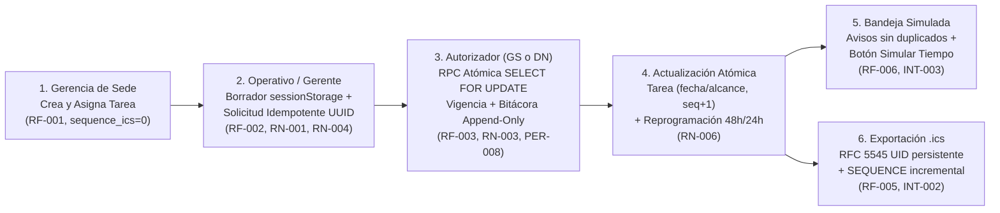

# Oficina Conecta — Sistema Web de Gestión Multisede


Plataforma web centralizada para la gestión operativa, control documental, flujo de autorizaciones atómicas y seguimiento de fechas límite en **3 sedes piloto**, desarrollada por el **Grupo 502-A, Equipo I** con base en la especificación canónica [`502_A_1.pdf`](502_A_1.pdf) (Línea Base v1.0, acuerdo `FUE-011`).

🌐 **Aplicación en Producción:** [oficina-conecta-ingenieria-de-softw.vercel.app](https://oficina-conecta-ingenieria-de-softw.vercel.app)

---

## Tabla de Contenidos

1. [Alcance y Reglas de Negocio](#1-alcance-y-reglas-de-negocio)
2. [Arquitectura y Stack Tecnológico](#2-arquitectura-y-stack-tecnológico)
3. [Funcionalidades Principales](#3-funcionalidades-principales)
4. [Seguridad Implementada](#4-seguridad-implementada)
5. [Estructura del Repositorio](#5-estructura-del-repositorio)
6. [Instalación y Ejecución Local](#6-instalación-y-ejecución-local)
7. [Cuentas Piloto de Demostración](#7-cuentas-piloto-de-demostración)
8. [Scripts y Casos de Prueba (`CP-001` a `CP-007`)](#8-scripts-y-casos-de-prueba-cp-001-a-cp-007)
9. [Despliegue en Producción (Vercel + Supabase)](#9-despliegue-en-producción-vercel--supabase)
10. [Documentación Técnica Relacionada](#10-documentación-técnica-relacionada)

---

## 1. Alcance y Reglas de Negocio

* **Alcance cerrado (`RES-001`):** Opera exclusivamente sobre **3 sedes piloto** y sus departamentos internos:
  * **Ciudad de México (`CDMX`):** *Operaciones*, *Infraestructura*
  * **Oaxaca de Juárez (`OAXACA`):** *Logística*, *Supervisión Regional*
  * **Puebla de Zaragoza (`PUEBLA`):** *Mantenimiento*, *Redes y Soporte*
* **Zona horaria (`RES-003`):** Toda evaluación de negocio se realiza en `America/Mexico_City`; almacenamiento en PostgreSQL como `TIMESTAMPTZ` (UTC).
* **Exclusiones estrictas (`RES-002`):**
  * Sin módulos de presupuesto o costos.
  * Sin firma digital criptográfica.
  * Sin captura ni almacenamiento de direcciones IP en tablas, bitácoras o rate limiters.
  * Sin integración directa por API con calendarios externos de Google o Microsoft (se exporta `.ics` estándar).

---

## 2. Arquitectura y Stack Tecnológico

| Decisión | Tecnología / Estrategia |
| :--- | :--- |
| **DEC-001 (Fullstack UI)** | Next.js 14 (App Router), TypeScript estricto, Tailwind CSS y Lucide Icons |
| **DEC-002 (Base de Datos)** | Supabase PostgreSQL 15 (`us-east-1`) con respaldo de **Motor Local Transaccional ACID** (`.oficina-conecta-local-db.json`) cuando no hay variables de Supabase |
| **DEC-003 (Autenticación y Sesión)** | Supabase Auth + monitor real de actividad en cliente (modal de aviso al minuto **13** y cierre forzado con purga de `sessionStorage` al minuto **15**, incluso sin conexión) |
| **DEC-004 (Control Documental)** | Bucket privado `documentos-tareas` en Supabase Storage, versionado consecutivo (`v1`, `v2`, `v3`...) y detección de hash `SHA-256` duplicado por documento |
| **DEC-005 (Atomicidad y Bitácora)** | Funciones PL/pgSQL (`SECURITY DEFINER`) con `SELECT ... FOR UPDATE`, claves de idempotencia UUID y Row Level Security (RLS) en las 10 tablas |
| **DEC-006 (Notificaciones)** | Tabla `correos_simulados` idempotente, Bandeja Simulada y simulador explícito de paso del tiempo (`48h` / `24h`) |



---

## 3. Funcionalidades Principales

* **Matriz RBAC Estricto (`PER-001` a `PER-007`):**
  * **Personal Operativo (`OP`):** Ve y reporta avance únicamente sobre sus tareas asignadas; sube revisiones documentales y envía solicitudes.
  * **Gerencia de Sede (`GS`):** Administra departamentos, proyectos y tareas de su sede; resuelve prórrogas `<= 5 días naturales` que no excedan la fecha fin del proyecto; **único rol** facultado para designar una versión documental como *Oficial / Vigente*.
  * **Dirección Nacional (`DN`):** Consulta transversal de las 3 sedes y métricas globales; resuelve prórrogas `> 5 días`, ampliaciones de fin de proyecto, cambios de alcance y solicitudes emitidas por gerentes. Ningún rol puede auto-autorizar su propia solicitud (`ERR-003`).
* **Transaccionalidad, Concurrencia e Invalidación (`CP-002` a `CP-004`):**
  * Aprobar una solicitud actualiza la tarea, registra la resolución en `bitacora_autorizaciones` y emite aviso dentro de la misma transacción (`ROLLBACK` total ante fallo).
  * Resoluciones simultáneas usan `SELECT ... FOR UPDATE`: la primera gana y las subsecuentes reciben `HTTP 409 ERR-004` indicando autorizador, dictamen y fecha.
  * Si cambia `fecha_limite` de la tarea antes de resolver, las solicitudes pendientes transicionan a `INVALIDADA_POR_DESACTUALIZACION` conservando ambos motivos.
  * Borradores locales en `sessionStorage` etiquetados *"Borrador local no guardado en servidor"* con `idempotency_key` UUID estable (sin auto-envío al reconectar).
* **Bitácora Inmutable *Append-Only* (`CP-001`):** Privilegios `UPDATE`, `DELETE` y `TRUNCATE` revocados + trigger SQL que bloquea mutaciones con `SQLSTATE 42501` (`HTTP 403`).
* **Calendario `.ics` RFC 5545 (`CP-006`):** `UID` fijo (`tarea-{id}@oficinaconecta.mx`), `SEQUENCE` incremental y line-folding UTF-8 de 75 octetos compatible con Google Calendar y Mozilla Thunderbird.
* **Notificaciones Simuladas (`CP-005`):** Gestión de `ASIGNACION`, `SOLICITUD`, `RESOLUCION` y recordatorios `48h`/`24h` (plazo `<24h` urgente sin recordatorios, umbrales exactos combinados, cancelación automática al completar/cancelar tarea y 0 duplicados).
* **Preferencias de Usuario e Interfaz Responsiva (*Mobile-First*):**
  * Pestaña `/preferencias` con selector de idioma (`es-MX`, `en-US`, `pt-BR`), temas (`Claro Institucional`, `Oscuro Nocturno`, `Azul Corporativo Oscuro`, `Automático del Sistema`), densidad visual y ficha/directorio por rol.
  * Adaptado a móviles y tablets: barra inferior fija, drawer lateral táctil, tablas convertidas a tarjetas en móvil, modales *bottom-sheet* y prevención de auto-zoom en iOS/Android.

---

## 4. Seguridad Implementada

* **Cabeceras HTTP de Seguridad** en [`next.config.mjs`](next.config.mjs): `Content-Security-Policy` (`frame-ancestors 'none'`, `object-src 'none'`), `X-Frame-Options: DENY`, `X-Content-Type-Options: nosniff`, `Referrer-Policy`, `Permissions-Policy`, `Strict-Transport-Security` y `poweredByHeader: false`.
* **Defensa CSRF:** Validación de `Origin` vs `Host` y `Sec-Fetch-Site` en todos los endpoints mutadores (`POST`, `PUT`, `PATCH`, `DELETE`).
* **Rate Limiting sin IPs (`RES-002`):** Limitación en memoria por cuenta/actor (`HTTP 429`) en inicio de sesión, subida de documentos y solicitudes.
* **Validación Estricta de Entradas y Carga de Archivos:** Verificación de UUIDs, longitudes máximas, límite de `50 MB` previo a lectura en memoria, bloqueo de extensiones/MIME activos (`.html`, `.svg`, `.js`, `.exe`, etc.), Signed URLs con descarga forzada (`Content-Disposition: attachment`) y sanitización de errores SQL/Auth internos.
* **Aislamiento en Base de Datos y Storage:** RLS habilitado en todas las tablas y bucket privado `documentos-tareas`.

---

## 5. Estructura del Repositorio

```text
├── docs/
│   ├── adr/                         # Decisiones arquitectónicas (0001, 0002)
│   ├── evidencias/cp006/            # Archivos .ics v0/v1 de evidencia
│   ├── EVIDENCIA_CASOS_PRUEBA.md    # Registro de evidencia CP-001..CP-007
│   └── PLAN_IMPLEMENTACION.md       # Plan técnico completo y contratos DDL/RPC
├── scripts/
│   ├── seed-users.ts                # Alta de usuarios piloto y proyectos base en Supabase
│   └── verify-all-cp.ts             # Suite ATDD integral (E2E + CP-001..CP-007)
├── src/
│   ├── app/
│   │   ├── (dashboard)/             # Rutas protegidas (/, /tareas, /proyectos, /autorizaciones, /bitacora, /notificaciones, /preferencias)
│   │   ├── api/                     # Endpoints REST (/auth, /tareas, /proyectos, /solicitudes, /bitacora, /documentos, /notificaciones, /calendario, /dashboard)
│   │   ├── login/page.tsx           # Acceso autenticado
│   │   ├── globals.css              # Estilos globales, temas dark/midnight y reglas móviles
│   │   └── layout.tsx               # Root layout, metadata y viewport-fit=cover
│   ├── components/                  # Componentes UI por dominio (autorizaciones, bitácora, documentos, layout, notificaciones, preferences, proyectos, session, tareas)
│   ├── hooks/                       # useIdempotentDraft y useInactivityTimer (13m/15m)
│   └── lib/
│       ├── backend/                 # adapter.ts (Supabase <-> Local), localEngine.ts, http.ts
│       ├── crypto/                  # sha256.ts
│       ├── dates/                   # mexicoCity.ts
│       ├── errors/                  # mapRpcError.ts (ERR-001..ERR-005)
│       ├── ics/                     # generator.ts (RFC 5545)
│       ├── security/                # validation.ts y rateLimit.ts
│       └── supabase/                # client.ts, server.ts, types.ts
├── supabase/migrations/
│   ├── 0001_schema_y_restricciones.sql
│   ├── 0002_rls_y_storage.sql
│   ├── 0003_funciones_rpc.sql
│   └── 0004_seed_piloto.sql
├── tests/unit/                      # Pruebas unitarias con Vitest
├── GLOSSARY.md                      # Glosario canónico del dominio
├── .env.example                     # Plantilla de variables de entorno
└── next.config.mjs                  # Configuración Next.js y cabeceras HTTP de seguridad
```

---

## 6. Instalación y Ejecución Local

### Requisitos
* **Node.js** `20+` (recomendado `20` o `22` LTS) y `npm`.
* *(Opcional)* Proyecto en [Supabase](https://supabase.com). Si no configuras variables de Supabase, la app arranca automáticamente usando el **Motor Local Transaccional ACID**.

### Pasos

1. **Clonar e instalar dependencias:**
   ```bash
   git clone https://github.com/JaimeVGA/Oficina-Conecta-Ingenieria-de-software-.git
   cd Oficina-Conecta-Ingenieria-de-software-
   npm install
   ```

2. **Configurar variables de entorno:**
   Copia [`.env.example`](.env.example) a `.env.local`:
   ```env
   NEXT_PUBLIC_SUPABASE_URL=https://TU_PROYECTO.supabase.co
   NEXT_PUBLIC_SUPABASE_ANON_KEY=tu_publishable_o_anon_key
   SUPABASE_SERVICE_ROLE_KEY=tu_secret_o_service_role_key
   NEXT_PUBLIC_ENABLE_DEMO_TOOLS=true
   ```
   *(Deja vacías las 3 variables de Supabase si deseas probar en modo Motor Local).*

3. **Inicializar Supabase (si usas base de datos en la nube):**
   Ejecuta en orden estricto los scripts de `supabase/migrations/` en el **SQL Editor** de Supabase:
   1. `0001_schema_y_restricciones.sql`
   2. `0002_rls_y_storage.sql`
   3. `0003_funciones_rpc.sql`
   4. `0004_seed_piloto.sql`

   Luego siembra los 8 usuarios piloto en Auth y los proyectos iniciales:
   ```bash
   node --env-file=.env.local --import tsx scripts/seed-users.ts
   ```

4. **Levantar servidor de desarrollo:**
   ```bash
   npm run dev
   ```
   Abre [http://localhost:3000](http://localhost:3000).

---

## 7. Cuentas Piloto de Demostración

Contraseña por defecto de cuentas piloto (configurable vía `DEMO_USER_PASSWORD`): `OficinaConecta2026!`

| Rol | Nombre | Correo institucional | Sede |
| :--- | :--- | :--- | :--- |
| **Dirección Nacional (`DN`)** | Roberto Salinas | `roberto.salinas@oficinaconecta.mx` | Global (Todas) |
| **Gerencia de Sede (`GS`)** | Carlos Méndez | `carlos.mendez@oficinaconecta.mx` | Puebla (`PUEBLA`) |
| **Gerencia de Sede (`GS`)** | Laura Gómez | `laura.gomez@oficinaconecta.mx` | CDMX (`CDMX`) |
| **Gerencia de Sede (`GS`)** | Elena Vásquez | `elena.vasquez@oficinaconecta.mx` | Oaxaca (`OAXACA`) |
| **Personal Operativo (`OP`)** | Sofía Morales | `sofia.morales@oficinaconecta.mx` | Puebla (`Mantenimiento`) |
| **Personal Operativo (`OP`)** | Pedro Ramírez | `pedro.ramirez@oficinaconecta.mx` | Puebla (`Redes y Soporte`) |
| **Personal Operativo (`OP`)** | Miguel Torres | `miguel.torres@oficinaconecta.mx` | CDMX (`Operaciones`) |
| **Personal Operativo (`OP`)** | Diego Cruz | `diego.cruz@oficinaconecta.mx` | Oaxaca (`Logística`) |

---

## 8. Scripts y Casos de Prueba (`CP-001` a `CP-007`)

| Comando | Descripción |
| :--- | :--- |
| `npm run dev` | Inicia Next.js en modo desarrollo |
| `npm run build` | Compila la aplicación para producción |
| `npm run typecheck` | Verificación estricta de TypeScript (`tsc --noEmit`) |
| `npm test` | Ejecuta las pruebas unitarias con Vitest (`tests/unit/`) |
| `npm run verify:cp` | Ejecuta el recorrido E2E completo y valida `CP-001` a `CP-007` |
| `npm run seed` | Crea usuarios piloto y proyectos base en Supabase (`scripts/seed-users.ts`) |

### Cobertura de Casos de Prueba
* **`CP-001`:** Bitácora *append-only* (`HTTP 403` / `SQLSTATE 42501` ante `PUT`/`PATCH`/`DELETE`).
* **`CP-002`:** Concurrencia con `SELECT ... FOR UPDATE` (`ERR-004`) y `ROLLBACK` atómico ante fallo en bitácora.
* **`CP-003`:** Idempotencia con `UUID-K1`, borradores locales sin auto-envío e inactividad `13m`/`15m` offline.
* **`CP-004`:** Invalidación automática (`INVALIDADA_POR_DESACTUALIZACION`) conservando motivo original e invalidación.
* **`CP-005`:** 5 umbrales de recordatorios (`48h`/`24h`/`<24h`), cancelación al completar y 0 duplicados.
* **`CP-006`:** Exportación `.ics` RFC 5545 (`UID` persistente y `SEQUENCE` incremental).
* **`CP-007`:** Versionado documental `v1`/`v2`, detección de `SHA-256` duplicado, vigencia exclusiva `GS` y aislamiento RBAC.

---

## 9. Despliegue en Producción (Vercel + Supabase)

1. Configura en **Vercel → Settings → Environment Variables** (`Production`, `Preview`, `Development`):
   * `NEXT_PUBLIC_SUPABASE_URL` (URL base sin `/rest/v1/`, ej. `https://tu-ref.supabase.co`)
   * `NEXT_PUBLIC_SUPABASE_ANON_KEY`
   * `SUPABASE_SERVICE_ROLE_KEY`
   * `NEXT_PUBLIC_ENABLE_DEMO_TOOLS` (`true` para demo académica; `false` para operación productiva real)
2. En **Supabase → Authentication → URL Configuration**, registra tu dominio de Vercel en **Site URL** y **Redirect URLs** (`https://tu-app.vercel.app/**`).
3. **Checklist de endurecimiento previo a uso productivo real:**
   * Cambiar `NEXT_PUBLIC_ENABLE_DEMO_TOOLS=false` en Vercel.
   * Desactivar **"Allow new users to sign up"** en **Supabase → Authentication**.
   * Establecer `permitir_fallo_bitacora_cp002 = FALSE` en la tabla `public.configuracion_pruebas`.

---

## 10. Documentación Técnica Relacionada

* [Glosario de Dominio (`GLOSSARY.md`)](GLOSSARY.md)
* [Plan Técnico de Implementación](docs/PLAN_IMPLEMENTACION.md)
* [Evidencia de Casos de Prueba (`CP-001` a `CP-007`)](docs/EVIDENCIA_CASOS_PRUEBA.md)
* [ADR-0001: Concurrencia, Atomicidad y Bitácora Append-Only](docs/adr/0001-concurrencia-atomicidad-bitacora.md)
* [ADR-0002: Control Documental, Hash SHA-256 y Vigencia Exclusiva GS](docs/adr/0002-control-documental-vigencia-gerencia.md)
