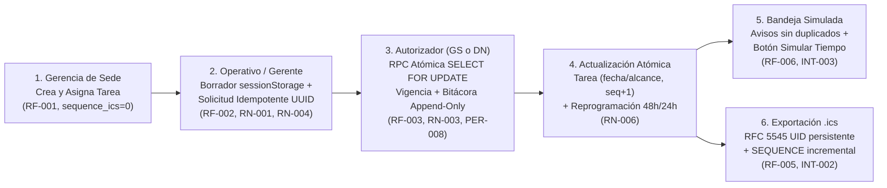
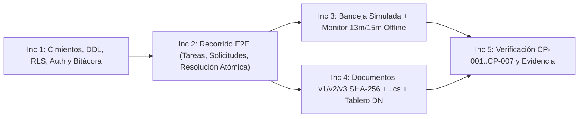

# Plan Técnico de Implementación — Oficina Conecta (Grupo 502-A, Equipo I)

> **Estado:** Modo Planificación (no se ha escrito código en el repositorio).  
> **Fuente única de verdad:** [502_A_1.pdf](file:///C:/Users/corte/Documents/Oficina-Conecta-Ingenieria-de-software-/502_A_1.pdf) (Línea Base v1.0 aprobada el `2026-11-03`, acuerdo `FUE-011`).  
> **Decisiones técnicas aprobadas:** `DEC-001` a `DEC-006` (Next.js 14+ App Router, TypeScript estricto, Tailwind CSS, Lucide Icons, Supabase PostgreSQL 15 `us-east-1` Free Tier, Supabase Auth + monitor cliente 13m/15m, Supabase Storage privado `documentos-tareas`, PL/pgSQL RPC + RLS, simulador `correos_simulados`).

---

## 1. Objetivo y Arquitectura de Alto Nivel

Construir el Incremento 1 de **Oficina Conecta**, un sistema web multisede centralizado para las **3 sedes piloto cerradas** (**Ciudad de México**, **Oaxaca de Juárez** y **Puebla**), priorizando el **Recorrido Completo End-to-End** exigido por Roberto Salinas (`FUE-001`, `FUE-011`):



### Restricciones Inquebrantables (`RES-001` a `RES-003`)
- **Alcance cerrado:** Exactamente 3 sedes (`CDMX`, `OAXACA`, `PUEBLA`) con sus departamentos (`Operaciones`, `Infraestructura`, `Logística`, `Supervisión Regional`, `Mantenimiento`, `Redes y Soporte`).
- **Exclusiones estrictas (`RES-002`):** Prohibido incluir presupuesto/ajustes presupuestales, firma digital criptográfica (ni etiquetar la sesión como "firma digital"), captura/almacenamiento de direcciones IP en cualquier tabla o log de negocio, analizadores de texto/mínimo de 20 caracteres, servidores físicos locales y sincronización directa por API con Google/Microsoft.
- **Zona horaria (`RES-003`):** Referencia de negocio `America/Mexico_City`; almacenamiento estricto en `TIMESTAMPTZ` (UTC).
- **Rendimiento y calidad:** Consultas y exportación `.ics` $\le 2.5\text{ s}$ (`REN-001`), `0%` aprobaciones sin cambio aplicado (`CAL-001`), `100%` purga de `sessionStorage` al minuto 15 (`CAL-002`).

---

## 2. Entregable 1 — Detección de Ambigüedades y Conflictos Técnicos (Revisión Requerida)

| ID | Conflicto / Ambigüedad Detectada | Referencia en SRS | Impacto Técnico si se Ignora | Resolución Arquitectónica Propuesta |
|---|---|---|---|---|
| **AMB-01** | **Caso `CP-007` solicitado vs. Anexo A (`CP-001` a `CP-006`)** | Anexo A (p. 16) y §5.1 (p. 20) solo listan `CP-001` a `CP-006`. En cambio, `RF-004`/`PER-007` (versionado documental y vigencia exclusiva GS) y `PER-001..PER-004` (`Sec_block`, p. 17) no tienen CP dedicado. | Brecha de verificación documental/RBAC o conflicto de numeración frente a la rúbrica. | Conservar exactamente `CP-001` a `CP-005` (Demostración Parcial) y `CP-006` (Fase 2) fieles al PDF, y definir **`CP-007`** como caso integrador de **Control Documental (`RF-004`/`PER-006`/`PER-007`) y Aislamiento RBAC (`PER-001`..`PER-004`)**. |
| **AMB-02** | **Trampa de `ROLLBACK` al invalidar durante resolución (`RN-003` / `CP-004`)** | `RN-003` (p. 15) y `CP-004` (p. 16) exigen que, si `tarea.fecha_limite` cambió antes de hacer clic en resolver, la solicitud **quede guardada** en `INVALIDADA_POR_DESACTUALIZACION` (con ambos motivos) y responda `ERR-004` (HTTP 409). | Si la RPC ejecuta `UPDATE` y luego `RAISE EXCEPTION`, PostgreSQL hace `ROLLBACK` del `UPDATE` y la solicitud permanece en `PENDIENTE_REVISION`, fallando `CP-004`. | La RPC `resolver_solicitud_autorizacion` hará `COMMIT` de la transición a `INVALIDADA_POR_DESACTUALIZACION` (sin tocar `tareas` ni `bitacora_autorizaciones`) y devolverá JSON `{ ok: false, error_code: 'ERR-004', ... }`, mapeado por Next.js a **HTTP 409**. Solo un error en bitácora (`ERR-005`) lanza `RAISE EXCEPTION` para garantizar **ROLLBACK total**. |
| **AMB-03** | **Riesgo de deadlock en `SELECT ... FOR UPDATE`** | `RF-003` bloquea solicitud y tarea; editar tarea o aprobar otra prórroga bloquea tarea e invalida solicitudes pendientes. | Bloquear en órdenes inversos (`solicitud -> tarea` vs `tarea -> solicitud`) provoca deadlocks (`SQLSTATE 40P01`). | Imponer un **orden global de bloqueo obligatorio** en toda RPC: **(1) `tareas FOR UPDATE` $\rightarrow$ (2) `solicitudes_autorizacion FOR UPDATE` $\rightarrow$ (3) `proyectos FOR UPDATE`**. |
| **AMB-04** | **Prórroga que excede `fecha_fin_proyecto` aprobada por Dirección Nacional (`RN-001`)** | `RN-001` (p. 15): si la nueva fecha supera `proyectos.fecha_fin_proyecto`, escala a `DN`. El PDF no indica si al aprobar `DN` debe extenderse `fecha_fin_proyecto`. | Si `DN` aprueba una fecha posterior a `fecha_fin_proyecto` sin actualizar el proyecto, quedaría una tarea con vencimiento posterior al fin de su proyecto. | Cuando `DN` aprueba una `PRORROGA_FECHA` cuya fecha en `America/Mexico_City` supere `proyectos.fecha_fin_proyecto`, la misma transacción atómica actualiza `proyectos.fecha_fin_proyecto` y deja constancia en `bitacora_autorizaciones.valor_nuevo`. |
| **AMB-05** | **Cálculo de "≤ 5 días naturales" entre `TIMESTAMPTZ` (UTC) y `DATE` (`America/Mexico_City`)** | `DAT-001` (`DATE`), `DAT-002` (`TIMESTAMPTZ`), `RES-003` (`America/Mexico_City`), `RN-001` ($\Delta d \le 5$). | Restar fechas en UTC después de las 18:00 hora CDMX desplaza el día calendario +1 y asigna mal el rol resolutor (`GS` vs `DN`). | Calcular $\Delta d = (\text{fecha\_propuesta AT TIME ZONE 'America/Mexico\_City'})::\text{date} - (\text{fecha\_referencia AT TIME ZONE 'America/Mexico\_City'})::\text{date}$. Validar que `fecha_propuesta > fecha_referencia` y comparar `(fecha_propuesta AT TIME ZONE 'America/Mexico_City')::date > proyecto.fecha_fin_proyecto`. |
| **AMB-06** | **Umbrales "48h exactas" y "24h exactas" (`RN-006` / `CP-005`)** | `RN-006` (p. 15) separa `>48h`, `=48h`, `24h–48h`, `=24h`, `<24h` y `FUE-007` (p. 7) prohíbe crear un tipo de aviso extra para `<24h`. | Igualdad de microsegundos contra `now()` es prácticamente irreproducible desde formulario web. | Aplicar tolerancia determinista de **$\pm 60$ segundos** alrededor de `172800 s` (48h) y `86400 s` (24h). Mantener los motivos acordados (`ASIGNACION`, `SOLICITUD`, `RESOLUCION`, `RECORDATORIO_48H`/`RECORDATORIO_24H`) usando banderas `es_urgente_menor_24h` y `combina_recordatorio` (`'48H'`/`'24H'`). |
| **AMB-07** | **Expiración a los 15 min sin internet y en pestañas en segundo plano (`CP-003` / `INT-001`)** | P. 6–8 y `INT-001` (p. 11): purgar `sessionStorage` al minuto 15 con o sin conexión y al volver a una pestaña inactiva; impedir recuperar o reenviar el borrador. | 1) Chrome/Firefox throttlean `setTimeout` en pestañas ocultas. 2) `supabase.auth.signOut()` por defecto usa `scope: 'global'` (hace `POST /logout`) y falla/bloquea offline. | Persistir timestamp `oc_last_activity_ms` y validar `Date.now() - oc_last_activity_ms >= 900_000` en intervalo de 1s + listeners `visibilitychange`, `focus` y `pageshow`. Al expirar: (1) bloquear UI/desmontar formularios inmediatamente, (2) `sessionStorage.clear()`, (3) `supabase.auth.signOut({ scope: 'local' })` (no requiere red), (4) redirigir a `/login?reason=timeout`. |
| **AMB-08** | **Protección `SQLSTATE 42501` / `HTTP 403` real en `bitacora_autorizaciones` (`CP-001`)** | `PER-008` (p. 14) y `CP-001` (p. 16): petición directa `PUT/DELETE` al servidor y SQL `UPDATE/DELETE` deben devolver `HTTP 403 / SQLSTATE 42501`. | En PostgreSQL/PostgREST, una política RLS que no concede `UPDATE/DELETE` puede devolver `0 rows updated` (`HTTP 204`) en vez de `403/42501`. | Aplicar doble defensa: (1) `REVOKE INSERT, UPDATE, DELETE, TRUNCATE ON bitacora_autorizaciones FROM PUBLIC, anon, authenticated;` (garantiza `42501` en SQL y `403` en PostgREST/API), y (2) trigger `BEFORE UPDATE OR DELETE OR TRUNCATE` que lanza `ERRCODE = '42501'` incluso contra roles con permisos elevados. |
| **AMB-09** | **Idempotencia en resolución (`RF-003`) y visibilidad de `ERR-004`** | P. 4 (`FUE-005`): *"Reintentar no debe crear otra solicitud ni duplicar una resolución."* P. 5: *"El segundo intento debe informar claramente quién resolvió y cuál fue el resultado, siempre que el usuario tenga permiso para consultarlo."* | Sin `idempotency_key` en resolución, un reintento tras caída de red del mismo resolutor daría `ERR-004`. Además, informar quién resolvió antes de validar RBAC filtraría datos entre sedes. | Añadir `idempotency_key UUID UNIQUE` a `bitacora_autorizaciones`. La RPC primero valida RBAC (`PER-004`/`PER-005`/`ERR-001`/`ERR-003`); luego, si ya existe resolución con el mismo `idempotency_key` y `usuario_resolutor_id = auth.uid()`, retorna el resultado original idempotente; si fue otro usuario/UUID, devuelve `ERR-004` con nombre, dictamen y hora local. |
| **AMB-10** | **Demostración real de `ROLLBACK` por fallo en bitácora (`CP-002`)** | `CP-002` (p. 16): provocar fallo al insertar en bitácora y comprobar que la tarea conserva su fecha/alcance y la solicitud sigue en `PENDIENTE_REVISION`. | Mockear un error en Next.js no prueba la atomicidad real de PostgreSQL. | Trigger `BEFORE INSERT ON bitacora_autorizaciones` que aborta con `SQLSTATE 'P0005'` solo si `current_setting('app.simular_fallo_bitacora', true) = 'true'` y la tabla protegida `configuracion_pruebas` tiene `permitir_fallo_bitacora_cp002 = TRUE`. El fallo ocurre **después** de ejecutar `UPDATE tareas`, probando `ROLLBACK` nativo de PostgreSQL. |
| **AMB-11** | **Inconsistencia de nombres físicos de tablas entre PDF y `DEC-005/006`** | PDF pp. 12–16 usa `bitacora_autorizacion` y `AvisoSimulado`; `DEC-005`/`DEC-006` usan `bitacora_autorizaciones` y `correos_simulados`. | Errores de contrato entre sub-agentes. | Adoptar `bitacora_autorizaciones` y `correos_simulados` como nombres físicos oficiales en PostgreSQL y mapearlos explícitamente en tipos TypeScript y documentación contra `DAT-004` y `DAT-006`. |
| **AMB-12** | **Acciones de edición sobre `tareas` por `OP` vs `GS` y disparo de invalidación (`CP-004`)** | `PER-001` (OP consulta/avanza), `PER-002` (GS administra su sede), `CP-004` (la fecha cambia antes de resolver). | Si `OP` pudiera cambiar `fecha_limite` o `alcance`, eludiría las autorizaciones; si `GS` no pudiera ajustar una fecha local, no habría forma natural de reproducir `CP-004` salvo otra prórroga. | `OP` solo ejecuta `actualizar_avance_tarea` (`estado` $\in \{\text{ASIGNADA}, \text{EN\_PROCESO}, \text{COMPLETADA}\}$ y `porcentaje_avance`). `GS` ejecuta `actualizar_tarea_gerencia` en su sede (sin rebasar `fecha_fin_proyecto`). |
| **AMB-13** | **Invalidación inmediata vs. invalidación al hacer clic en resolver (`RN-003` vs. `CP-004`)** | P. 6: *"Si la fecha límite cambia mientras existía una prórroga pendiente, pasa automáticamente a `INVALIDADA_POR_DESACTUALIZACION`... Al hacer clic en Aprobar, el backend compara atómicamente la fecha de referencia contra la fecha actual."* | Si un trigger la marca `INVALIDADA_POR_DESACTUALIZACION` de inmediato al cambiar la fecha, la verificación al resolver también debe manejar ambos casos sin romperse. | Implementar **ambos resguardos**: (1) Al cambiar `tareas.fecha_limite` por aprobación de otra prórroga o edición de `GS`, las solicitudes pendientes pasan a `INVALIDADA_POR_DESACTUALIZACION`; (2) Al ejecutar `resolver_solicitud_autorizacion`, **siempre** se re-verifica `tarea.fecha_limite IS DISTINCT FROM solicitud.fecha_referencia`. |

---

## 3. Entregable 2 — Script SQL DDL Completo (PostgreSQL 15 / Supabase)

### 3.1 `0001_schema_y_restricciones.sql`

```sql
CREATE EXTENSION IF NOT EXISTS pgcrypto;

CREATE TABLE public.configuracion_pruebas (
  clave TEXT PRIMARY KEY,
  valor BOOLEAN NOT NULL DEFAULT FALSE,
  actualizado_en TIMESTAMPTZ NOT NULL DEFAULT now()
);
REVOKE ALL ON public.configuracion_pruebas FROM PUBLIC, anon, authenticated;
INSERT INTO public.configuracion_pruebas (clave, valor)
VALUES ('permitir_fallo_bitacora_cp002', TRUE)
ON CONFLICT (clave) DO NOTHING;

CREATE TABLE public.sedes (
  id TEXT PRIMARY KEY CHECK (id IN ('CDMX', 'OAXACA', 'PUEBLA')),
  codigo_corto TEXT NOT NULL UNIQUE CHECK (codigo_corto IN ('CDMX', 'OAX', 'PUE')),
  nombre TEXT NOT NULL UNIQUE,
  creado_en TIMESTAMPTZ NOT NULL DEFAULT now()
);

CREATE TABLE public.departamentos (
  id UUID PRIMARY KEY DEFAULT gen_random_uuid(),
  sede_id TEXT NOT NULL REFERENCES public.sedes(id) ON DELETE RESTRICT,
  nombre TEXT NOT NULL CHECK (length(btrim(nombre)) > 0),
  creado_en TIMESTAMPTZ NOT NULL DEFAULT now(),
  CONSTRAINT uq_departamentos_sede_nombre UNIQUE (sede_id, nombre),
  CONSTRAINT uq_departamentos_id_sede UNIQUE (id, sede_id)
);

CREATE TABLE public.perfiles_usuario (
  id UUID PRIMARY KEY REFERENCES auth.users(id) ON DELETE CASCADE,
  nombre_completo TEXT NOT NULL CHECK (length(btrim(nombre_completo)) > 0),
  correo TEXT NOT NULL UNIQUE CHECK (length(btrim(correo)) > 0),
  rol TEXT NOT NULL CHECK (rol IN ('OP', 'GS', 'DN')),
  sede_id TEXT NULL REFERENCES public.sedes(id) ON DELETE RESTRICT,
  departamento_id UUID NULL,
  activo BOOLEAN NOT NULL DEFAULT TRUE,
  creado_en TIMESTAMPTZ NOT NULL DEFAULT now(),
  CONSTRAINT chk_perfil_rol_sede CHECK (
    (rol = 'DN' AND sede_id IS NULL AND departamento_id IS NULL)
    OR (rol IN ('OP', 'GS') AND sede_id IS NOT NULL)
  ),
  CONSTRAINT fk_perfil_depto_misma_sede FOREIGN KEY (departamento_id, sede_id)
    REFERENCES public.departamentos(id, sede_id) ON DELETE RESTRICT,
  CONSTRAINT uq_perfil_id_sede UNIQUE (id, sede_id)
);

CREATE TABLE public.proyectos (
  id UUID PRIMARY KEY DEFAULT gen_random_uuid(),
  sede_id TEXT NOT NULL REFERENCES public.sedes(id) ON DELETE RESTRICT,
  departamento_id UUID NOT NULL,
  nombre TEXT NOT NULL CHECK (length(btrim(nombre)) > 0),
  descripcion TEXT NOT NULL DEFAULT '',
  fecha_fin_proyecto DATE NOT NULL,
  estado TEXT NOT NULL DEFAULT 'ACTIVO' CHECK (estado IN ('ACTIVO', 'COMPLETADO', 'CANCELADO')),
  creado_por UUID NOT NULL REFERENCES public.perfiles_usuario(id) ON DELETE RESTRICT,
  creado_en TIMESTAMPTZ NOT NULL DEFAULT now(),
  actualizado_en TIMESTAMPTZ NOT NULL DEFAULT now(),
  CONSTRAINT fk_proyecto_depto_misma_sede FOREIGN KEY (departamento_id, sede_id)
    REFERENCES public.departamentos(id, sede_id) ON DELETE RESTRICT,
  CONSTRAINT uq_proyecto_id_sede UNIQUE (id, sede_id)
);
CREATE INDEX idx_proyectos_sede ON public.proyectos (sede_id, estado);

CREATE SEQUENCE public.seq_folio_tarea START 1;

CREATE TABLE public.tareas (
  id UUID PRIMARY KEY DEFAULT gen_random_uuid(),
  folio TEXT NOT NULL UNIQUE,
  sede_id TEXT NOT NULL REFERENCES public.sedes(id) ON DELETE RESTRICT,
  proyecto_id UUID NOT NULL,
  departamento_id UUID NOT NULL,
  responsable_id UUID NOT NULL,
  titulo TEXT NOT NULL CHECK (length(btrim(titulo)) > 0),
  alcance TEXT NOT NULL CHECK (length(btrim(alcance)) > 0),
  fecha_limite TIMESTAMPTZ NOT NULL,
  estado TEXT NOT NULL DEFAULT 'ASIGNADA'
    CHECK (estado IN ('ASIGNADA', 'EN_PROCESO', 'COMPLETADA', 'CANCELADA')),
  porcentaje_avance INT NOT NULL DEFAULT 0 CHECK (porcentaje_avance BETWEEN 0 AND 100),
  sequence_ics INT NOT NULL DEFAULT 0 CHECK (sequence_ics >= 0),
  creado_por UUID NOT NULL REFERENCES public.perfiles_usuario(id) ON DELETE RESTRICT,
  creado_en TIMESTAMPTZ NOT NULL DEFAULT now(),
  actualizado_en TIMESTAMPTZ NOT NULL DEFAULT now(),
  CONSTRAINT fk_tarea_proyecto_sede FOREIGN KEY (proyecto_id, sede_id)
    REFERENCES public.proyectos(id, sede_id) ON DELETE RESTRICT,
  CONSTRAINT fk_tarea_depto_sede FOREIGN KEY (departamento_id, sede_id)
    REFERENCES public.departamentos(id, sede_id) ON DELETE RESTRICT,
  CONSTRAINT fk_tarea_responsable_sede FOREIGN KEY (responsable_id, sede_id)
    REFERENCES public.perfiles_usuario(id, sede_id) ON DELETE RESTRICT,
  CONSTRAINT uq_tarea_id_sede UNIQUE (id, sede_id)
);
CREATE INDEX idx_tareas_sede_estado ON public.tareas (sede_id, estado);
CREATE INDEX idx_tareas_responsable ON public.tareas (responsable_id);
CREATE INDEX idx_tareas_proyecto ON public.tareas (proyecto_id);
CREATE INDEX idx_tareas_fecha_limite ON public.tareas (fecha_limite);

CREATE SEQUENCE public.seq_folio_solicitud START 1;

CREATE TABLE public.solicitudes_autorizacion (
  id UUID PRIMARY KEY DEFAULT gen_random_uuid(),
  folio TEXT NOT NULL UNIQUE,
  tarea_id UUID NOT NULL,
  sede_id TEXT NOT NULL REFERENCES public.sedes(id) ON DELETE RESTRICT,
  solicitante_id UUID NOT NULL REFERENCES public.perfiles_usuario(id) ON DELETE RESTRICT,
  idempotency_key UUID NOT NULL,
  tipo TEXT NOT NULL CHECK (tipo IN ('PRORROGA_FECHA', 'CAMBIO_ALCANCE')),
  fecha_referencia TIMESTAMPTZ NOT NULL,
  alcance_referencia TEXT NOT NULL,
  fecha_propuesta TIMESTAMPTZ NULL,
  alcance_propuesto TEXT NULL,
  dias_naturales_solicitados INT NULL,
  cambio_solicitado TEXT NOT NULL CHECK (length(btrim(cambio_solicitado)) > 0),
  motivo_solicitud TEXT NOT NULL CHECK (length(btrim(motivo_solicitud)) > 0),
  rol_resolver TEXT NOT NULL CHECK (rol_resolver IN ('GS', 'DN')),
  estado TEXT NOT NULL DEFAULT 'PENDIENTE_REVISION'
    CHECK (estado IN ('PENDIENTE_REVISION', 'APROBADA', 'RECHAZADA', 'INVALIDADA_POR_DESACTUALIZACION')),
  motivo_invalidacion TEXT NULL,
  invalidada_en TIMESTAMPTZ NULL,
  creado_en TIMESTAMPTZ NOT NULL DEFAULT now(),
  actualizado_en TIMESTAMPTZ NOT NULL DEFAULT now(),
  CONSTRAINT uq_solicitud_idempotencia UNIQUE (solicitante_id, idempotency_key),
  CONSTRAINT fk_solicitud_tarea_sede FOREIGN KEY (tarea_id, sede_id)
    REFERENCES public.tareas(id, sede_id) ON DELETE RESTRICT,
  CONSTRAINT chk_solicitud_payload_por_tipo CHECK (
    (tipo = 'PRORROGA_FECHA' AND fecha_propuesta IS NOT NULL AND fecha_propuesta > fecha_referencia AND alcance_propuesto IS NULL)
    OR
    (tipo = 'CAMBIO_ALCANCE' AND alcance_propuesto IS NOT NULL AND length(btrim(alcance_propuesto)) > 0 AND fecha_propuesta IS NULL)
  ),
  CONSTRAINT chk_solicitud_motivo_invalidacion CHECK (
    (estado = 'INVALIDADA_POR_DESACTUALIZACION' AND motivo_invalidacion IS NOT NULL AND length(btrim(motivo_invalidacion)) > 0 AND invalidada_en IS NOT NULL)
    OR
    (estado <> 'INVALIDADA_POR_DESACTUALIZACION' AND motivo_invalidacion IS NULL AND invalidada_en IS NULL)
  )
);
CREATE INDEX idx_solicitudes_tarea_estado ON public.solicitudes_autorizacion (tarea_id, estado);
CREATE INDEX idx_solicitudes_sede_rol_estado ON public.solicitudes_autorizacion (sede_id, rol_resolver, estado);

CREATE TABLE public.bitacora_autorizaciones (
  id UUID PRIMARY KEY DEFAULT gen_random_uuid(),
  solicitud_id UUID NOT NULL UNIQUE REFERENCES public.solicitudes_autorizacion(id) ON DELETE RESTRICT,
  tarea_id UUID NOT NULL,
  sede_id TEXT NOT NULL REFERENCES public.sedes(id) ON DELETE RESTRICT,
  usuario_resolutor_id UUID NOT NULL REFERENCES public.perfiles_usuario(id) ON DELETE RESTRICT,
  resolutor_nombre_snapshot TEXT NOT NULL CHECK (length(btrim(resolutor_nombre_snapshot)) > 0),
  resolutor_rol_snapshot TEXT NOT NULL CHECK (resolutor_rol_snapshot IN ('GS', 'DN')),
  idempotency_key UUID NULL UNIQUE,
  dictamen TEXT NOT NULL CHECK (dictamen IN ('APROBADA', 'RECHAZADA')),
  motivo_resolucion TEXT NOT NULL CHECK (length(btrim(motivo_resolucion)) > 0),
  valor_anterior TEXT NOT NULL,
  valor_nuevo TEXT NOT NULL,
  resuelto_en TIMESTAMPTZ NOT NULL DEFAULT now(),
  CONSTRAINT fk_bitacora_tarea_sede FOREIGN KEY (tarea_id, sede_id)
    REFERENCES public.tareas(id, sede_id) ON DELETE RESTRICT
);
CREATE INDEX idx_bitacora_tarea ON public.bitacora_autorizaciones (tarea_id, resuelto_en DESC);
CREATE INDEX idx_bitacora_sede ON public.bitacora_autorizaciones (sede_id, resuelto_en DESC);

REVOKE INSERT, UPDATE, DELETE, TRUNCATE ON public.bitacora_autorizaciones FROM PUBLIC, anon, authenticated;
GRANT SELECT ON public.bitacora_autorizaciones TO authenticated;

CREATE OR REPLACE FUNCTION public.fn_bloquear_mutacion_bitacora()
RETURNS TRIGGER LANGUAGE plpgsql AS $$
BEGIN
  RAISE EXCEPTION 'ERR-005: La bitácora de autorizaciones es de solo adición (append-only). Operación % prohibida.', TG_OP
    USING ERRCODE = '42501';
END;
$$;

CREATE TRIGGER trg_bloquear_mutacion_bitacora
  BEFORE UPDATE OR DELETE OR TRUNCATE ON public.bitacora_autorizaciones
  FOR EACH STATEMENT EXECUTE FUNCTION public.fn_bloquear_mutacion_bitacora();

CREATE OR REPLACE FUNCTION public.fn_cp002_fallo_simulado_bitacora()
RETURNS TRIGGER LANGUAGE plpgsql AS $$
BEGIN
  IF current_setting('app.simular_fallo_bitacora', true) = 'true' THEN
    RAISE EXCEPTION 'ERR-005: Fallo provocado en escritura de bitácora (CP-002).'
      USING ERRCODE = 'P0005';
  END IF;
  RETURN NEW;
END;
$$;

CREATE TRIGGER trg_cp002_fallo_simulado_bitacora
  BEFORE INSERT ON public.bitacora_autorizaciones
  FOR EACH ROW EXECUTE FUNCTION public.fn_cp002_fallo_simulado_bitacora();

CREATE TABLE public.documentos_tarea (
  id UUID PRIMARY KEY DEFAULT gen_random_uuid(),
  tarea_id UUID NOT NULL,
  sede_id TEXT NOT NULL REFERENCES public.sedes(id) ON DELETE RESTRICT,
  nombre_documento TEXT NOT NULL CHECK (length(btrim(nombre_documento)) > 0),
  creado_por UUID NOT NULL REFERENCES public.perfiles_usuario(id) ON DELETE RESTRICT,
  creado_en TIMESTAMPTZ NOT NULL DEFAULT now(),
  CONSTRAINT fk_doc_tarea_sede FOREIGN KEY (tarea_id, sede_id)
    REFERENCES public.tareas(id, sede_id) ON DELETE RESTRICT,
  CONSTRAINT uq_doc_tarea_nombre UNIQUE (tarea_id, nombre_documento),
  CONSTRAINT uq_doc_id_sede UNIQUE (id, sede_id)
);

CREATE TABLE public.documento_versiones (
  id UUID PRIMARY KEY DEFAULT gen_random_uuid(),
  documento_id UUID NOT NULL,
  sede_id TEXT NOT NULL REFERENCES public.sedes(id) ON DELETE RESTRICT,
  numero_version INT NOT NULL CHECK (numero_version >= 1),
  etiqueta TEXT GENERATED ALWAYS AS ('v' || numero_version::text) STORED,
  archivo_path TEXT NOT NULL CHECK (length(btrim(archivo_path)) > 0),
  nombre_original TEXT NOT NULL CHECK (length(btrim(nombre_original)) > 0),
  mime_type TEXT NOT NULL DEFAULT 'application/octet-stream',
  tamano_bytes BIGINT NOT NULL CHECK (tamano_bytes > 0 AND tamano_bytes <= 52428800),
  hash_sha256 TEXT NOT NULL CHECK (hash_sha256 ~ '^[0-9a-f]{64}$'),
  hash_duplicado_en_documento BOOLEAN NOT NULL DEFAULT FALSE,
  autor_id UUID NOT NULL REFERENCES public.perfiles_usuario(id) ON DELETE RESTRICT,
  descripcion_cambio TEXT NOT NULL CHECK (length(btrim(descripcion_cambio)) > 0),
  es_vigente BOOLEAN NOT NULL DEFAULT FALSE,
  designada_por UUID NULL REFERENCES public.perfiles_usuario(id) ON DELETE RESTRICT,
  designada_en TIMESTAMPTZ NULL,
  creado_en TIMESTAMPTZ NOT NULL DEFAULT now(),
  CONSTRAINT fk_version_doc_sede FOREIGN KEY (documento_id, sede_id)
    REFERENCES public.documentos_tarea(id, sede_id) ON DELETE RESTRICT,
  CONSTRAINT uq_doc_numero_version UNIQUE (documento_id, numero_version)
);

CREATE UNIQUE INDEX uq_documento_unica_version_vigente
  ON public.documento_versiones (documento_id) WHERE es_vigente = TRUE;
CREATE INDEX idx_versiones_doc_hash ON public.documento_versiones (documento_id, hash_sha256);

CREATE TABLE public.correos_simulados (
  id UUID PRIMARY KEY DEFAULT gen_random_uuid(),
  clave_evento TEXT NOT NULL UNIQUE,
  sede_id TEXT NOT NULL REFERENCES public.sedes(id) ON DELETE RESTRICT,
  destinatario_usuario_id UUID NULL REFERENCES public.perfiles_usuario(id) ON DELETE RESTRICT,
  destinatario TEXT NOT NULL CHECK (length(btrim(destinatario)) > 0),
  motivo_aviso TEXT NOT NULL CHECK (
    motivo_aviso IN ('ASIGNACION', 'SOLICITUD', 'RESOLUCION', 'RECORDATORIO_48H', 'RECORDATORIO_24H')
  ),
  es_urgente_menor_24h BOOLEAN NOT NULL DEFAULT FALSE,
  combina_recordatorio TEXT NULL CHECK (combina_recordatorio IN ('48H', '24H')),
  tarea_id UUID NULL REFERENCES public.tareas(id) ON DELETE RESTRICT,
  solicitud_id UUID NULL REFERENCES public.solicitudes_autorizacion(id) ON DELETE RESTRICT,
  asunto TEXT NOT NULL CHECK (length(btrim(asunto)) > 0),
  contenido TEXT NOT NULL CHECK (length(btrim(contenido)) > 0),
  fecha_hora_prevista TIMESTAMPTZ NOT NULL,
  emitido_en TIMESTAMPTZ NULL,
  es_simulado BOOLEAN NOT NULL DEFAULT TRUE CHECK (es_simulado = TRUE),
  estado TEXT NOT NULL CHECK (estado IN ('EMITIDO', 'PROGRAMADO', 'CANCELADO')),
  creado_en TIMESTAMPTZ NOT NULL DEFAULT now()
);
CREATE INDEX idx_correos_sede_estado ON public.correos_simulados (sede_id, estado, fecha_hora_prevista DESC);
CREATE INDEX idx_correos_tarea_estado ON public.correos_simulados (tarea_id, estado);
```

### 3.2 `0002_rls_y_storage.sql`

```sql
CREATE OR REPLACE FUNCTION public.auth_rol()
RETURNS TEXT LANGUAGE sql STABLE SECURITY DEFINER SET search_path = public AS $$
  SELECT rol FROM public.perfiles_usuario WHERE id = auth.uid() AND activo = TRUE;
$$;

CREATE OR REPLACE FUNCTION public.auth_sede_id()
RETURNS TEXT LANGUAGE sql STABLE SECURITY DEFINER SET search_path = public AS $$
  SELECT sede_id FROM public.perfiles_usuario WHERE id = auth.uid() AND activo = TRUE;
$$;

REVOKE ALL ON FUNCTION public.auth_rol() FROM PUBLIC;
GRANT EXECUTE ON FUNCTION public.auth_rol() TO authenticated;
REVOKE ALL ON FUNCTION public.auth_sede_id() FROM PUBLIC;
GRANT EXECUTE ON FUNCTION public.auth_sede_id() TO authenticated;

ALTER TABLE public.sedes ENABLE ROW LEVEL SECURITY;
ALTER TABLE public.departamentos ENABLE ROW LEVEL SECURITY;
ALTER TABLE public.perfiles_usuario ENABLE ROW LEVEL SECURITY;
ALTER TABLE public.proyectos ENABLE ROW LEVEL SECURITY;
ALTER TABLE public.tareas ENABLE ROW LEVEL SECURITY;
ALTER TABLE public.solicitudes_autorizacion ENABLE ROW LEVEL SECURITY;
ALTER TABLE public.bitacora_autorizaciones ENABLE ROW LEVEL SECURITY;
ALTER TABLE public.documentos_tarea ENABLE ROW LEVEL SECURITY;
ALTER TABLE public.documento_versiones ENABLE ROW LEVEL SECURITY;
ALTER TABLE public.correos_simulados ENABLE ROW LEVEL SECURITY;

REVOKE INSERT, UPDATE, DELETE ON public.tareas FROM anon, authenticated;
REVOKE INSERT, UPDATE, DELETE ON public.solicitudes_autorizacion FROM anon, authenticated;
REVOKE INSERT, UPDATE, DELETE ON public.documentos_tarea FROM anon, authenticated;
REVOKE INSERT, UPDATE, DELETE ON public.documento_versiones FROM anon, authenticated;
REVOKE INSERT, UPDATE, DELETE ON public.correos_simulados FROM anon, authenticated;

CREATE POLICY pol_sedes_select ON public.sedes FOR SELECT TO authenticated
USING (public.auth_rol() = 'DN' OR id = public.auth_sede_id());

CREATE POLICY pol_deptos_select ON public.departamentos FOR SELECT TO authenticated
USING (public.auth_rol() = 'DN' OR sede_id = public.auth_sede_id());
CREATE POLICY pol_deptos_gs_insert ON public.departamentos FOR INSERT TO authenticated
WITH CHECK (public.auth_rol() = 'GS' AND sede_id = public.auth_sede_id());
CREATE POLICY pol_deptos_gs_update ON public.departamentos FOR UPDATE TO authenticated
USING (public.auth_rol() = 'GS' AND sede_id = public.auth_sede_id())
WITH CHECK (public.auth_rol() = 'GS' AND sede_id = public.auth_sede_id());

CREATE POLICY pol_perfiles_select ON public.perfiles_usuario FOR SELECT TO authenticated
USING (id = auth.uid() OR public.auth_rol() = 'DN' OR (public.auth_rol() = 'GS' AND sede_id = public.auth_sede_id()));

CREATE POLICY pol_proyectos_select ON public.proyectos FOR SELECT TO authenticated
USING (
  public.auth_rol() = 'DN'
  OR (public.auth_rol() = 'GS' AND sede_id = public.auth_sede_id())
  OR (public.auth_rol() = 'OP' AND EXISTS (
    SELECT 1 FROM public.tareas t WHERE t.proyecto_id = proyectos.id AND t.responsable_id = auth.uid()
  ))
);
CREATE POLICY pol_proyectos_gs_insert ON public.proyectos FOR INSERT TO authenticated
WITH CHECK (public.auth_rol() = 'GS' AND sede_id = public.auth_sede_id() AND creado_por = auth.uid());
CREATE POLICY pol_proyectos_gs_update ON public.proyectos FOR UPDATE TO authenticated
USING (public.auth_rol() = 'GS' AND sede_id = public.auth_sede_id())
WITH CHECK (public.auth_rol() = 'GS' AND sede_id = public.auth_sede_id());

CREATE POLICY pol_tareas_select ON public.tareas FOR SELECT TO authenticated
USING (
  public.auth_rol() = 'DN'
  OR (public.auth_rol() = 'GS' AND sede_id = public.auth_sede_id())
  OR (public.auth_rol() = 'OP' AND responsable_id = auth.uid())
);

CREATE POLICY pol_solicitudes_select ON public.solicitudes_autorizacion FOR SELECT TO authenticated
USING (
  public.auth_rol() = 'DN'
  OR (public.auth_rol() = 'GS' AND sede_id = public.auth_sede_id())
  OR (public.auth_rol() = 'OP' AND EXISTS (
    SELECT 1 FROM public.tareas t WHERE t.id = solicitudes_autorizacion.tarea_id AND t.responsable_id = auth.uid()
  ))
);

CREATE POLICY pol_bitacora_select ON public.bitacora_autorizaciones FOR SELECT TO authenticated
USING (
  public.auth_rol() = 'DN'
  OR (public.auth_rol() = 'GS' AND sede_id = public.auth_sede_id())
  OR (public.auth_rol() = 'OP' AND EXISTS (
    SELECT 1 FROM public.tareas t WHERE t.id = bitacora_autorizaciones.tarea_id AND t.responsable_id = auth.uid()
  ))
);

CREATE POLICY pol_docs_select ON public.documentos_tarea FOR SELECT TO authenticated
USING (
  public.auth_rol() = 'DN'
  OR (public.auth_rol() = 'GS' AND sede_id = public.auth_sede_id())
  OR (public.auth_rol() = 'OP' AND EXISTS (
    SELECT 1 FROM public.tareas t WHERE t.id = documentos_tarea.tarea_id AND t.responsable_id = auth.uid()
  ))
);

CREATE POLICY pol_versiones_select ON public.documento_versiones FOR SELECT TO authenticated
USING (
  public.auth_rol() = 'DN'
  OR (public.auth_rol() = 'GS' AND sede_id = public.auth_sede_id())
  OR (public.auth_rol() = 'OP' AND EXISTS (
    SELECT 1 FROM public.documentos_tarea d
    JOIN public.tareas t ON t.id = d.tarea_id
    WHERE d.id = documento_versiones.documento_id AND t.responsable_id = auth.uid()
  ))
);

CREATE POLICY pol_correos_select ON public.correos_simulados FOR SELECT TO authenticated
USING (
  public.auth_rol() = 'DN'
  OR (public.auth_rol() = 'GS' AND sede_id = public.auth_sede_id())
  OR (public.auth_rol() = 'OP' AND (
    destinatario_usuario_id = auth.uid()
    OR EXISTS (SELECT 1 FROM public.tareas t WHERE t.id = correos_simulados.tarea_id AND t.responsable_id = auth.uid())
  ))
);

INSERT INTO storage.buckets (id, name, public, file_size_limit)
VALUES ('documentos-tareas', 'documentos-tareas', FALSE, 52428800)
ON CONFLICT (id) DO NOTHING;

CREATE POLICY pol_storage_docs_select ON storage.objects FOR SELECT TO authenticated
USING (
  bucket_id = 'documentos-tareas' AND (
    public.auth_rol() = 'DN'
    OR (public.auth_rol() = 'GS' AND (storage.foldername(name))[1] = public.auth_sede_id())
    OR (public.auth_rol() = 'OP' AND EXISTS (
      SELECT 1 FROM public.tareas t
      WHERE t.id::text = (storage.foldername(name))[2]
        AND t.sede_id = (storage.foldername(name))[1]
        AND t.responsable_id = auth.uid()
    ))
  )
);

CREATE POLICY pol_storage_docs_insert ON storage.objects FOR INSERT TO authenticated
WITH CHECK (
  bucket_id = 'documentos-tareas' AND (
    (public.auth_rol() = 'GS' AND (storage.foldername(name))[1] = public.auth_sede_id())
    OR (public.auth_rol() = 'OP' AND EXISTS (
      SELECT 1 FROM public.tareas t
      WHERE t.id::text = (storage.foldername(name))[2]
        AND t.sede_id = (storage.foldername(name))[1]
        AND t.responsable_id = auth.uid()
    ))
  )
);
```

### 3.3 `0003_funciones_rpc.sql`

```sql
CREATE OR REPLACE FUNCTION public._programar_avisos_tarea(
  p_tarea_id UUID,
  p_incluir_asignacion BOOLEAN,
  p_ahora TIMESTAMPTZ DEFAULT now()
)
RETURNS VOID LANGUAGE plpgsql SECURITY DEFINER SET search_path = public AS $$
DECLARE
  v_t RECORD;
  v_diff_sec NUMERIC;
  v_fecha_mx TEXT;
BEGIN
  SELECT t.id, t.folio, t.sede_id, t.titulo, t.fecha_limite, t.estado, t.sequence_ics,
         t.responsable_id, p.nombre AS proyecto_nombre,
         u.correo AS resp_correo, u.nombre_completo AS resp_nombre
  INTO v_t
  FROM public.tareas t
  JOIN public.proyectos p ON p.id = t.proyecto_id
  JOIN public.perfiles_usuario u ON u.id = t.responsable_id
  WHERE t.id = p_tarea_id;

  IF NOT FOUND THEN RETURN; END IF;

  UPDATE public.correos_simulados
  SET estado = 'CANCELADO'
  WHERE tarea_id = p_tarea_id
    AND motivo_aviso IN ('RECORDATORIO_48H', 'RECORDATORIO_24H')
    AND estado = 'PROGRAMADO';

  IF v_t.estado IN ('COMPLETADA', 'CANCELADA') THEN RETURN; END IF;

  v_fecha_mx := to_char(v_t.fecha_limite AT TIME ZONE 'America/Mexico_City', 'YYYY-MM-DD HH24:MI') || ' (America/Mexico_City)';
  v_diff_sec := EXTRACT(EPOCH FROM (v_t.fecha_limite - p_ahora));

  IF v_diff_sec > (48 * 3600 + 60) THEN
    IF p_incluir_asignacion THEN
      INSERT INTO public.correos_simulados (
        clave_evento, sede_id, destinatario_usuario_id, destinatario, motivo_aviso,
        tarea_id, asunto, contenido, fecha_hora_prevista, emitido_en, estado
      ) VALUES (
        format('tarea:%s:seq:%s:asig', v_t.id, v_t.sequence_ics), v_t.sede_id, v_t.responsable_id, v_t.resp_correo, 'ASIGNACION',
        v_t.id, format('[SIMULADO] Asignación de tarea %s: %s', v_t.folio, v_t.titulo),
        format('Hola %s, se te asignó "%s" (%s) en "%s". Fecha límite vigente: %s.', v_t.resp_nombre, v_t.titulo, v_t.folio, v_t.proyecto_nombre, v_fecha_mx),
        p_ahora, p_ahora, 'EMITIDO'
      ) ON CONFLICT (clave_evento) DO NOTHING;
    END IF;
    INSERT INTO public.correos_simulados (
      clave_evento, sede_id, destinatario_usuario_id, destinatario, motivo_aviso,
      tarea_id, asunto, contenido, fecha_hora_prevista, estado
    ) VALUES
    (format('tarea:%s:seq:%s:rec48', v_t.id, v_t.sequence_ics), v_t.sede_id, v_t.responsable_id, v_t.resp_correo, 'RECORDATORIO_48H',
     v_t.id, format('[SIMULADO] Recordatorio 48h — %s: %s', v_t.folio, v_t.titulo),
     format('Recordatorio preventivo (48h): "%s" (%s) vence el %s.', v_t.titulo, v_t.folio, v_fecha_mx),
     v_t.fecha_limite - INTERVAL '48 hours', 'PROGRAMADO'),
    (format('tarea:%s:seq:%s:rec24', v_t.id, v_t.sequence_ics), v_t.sede_id, v_t.responsable_id, v_t.resp_correo, 'RECORDATORIO_24H',
     v_t.id, format('[SIMULADO] Recordatorio 24h — %s: %s', v_t.folio, v_t.titulo),
     format('Recordatorio preventivo (24h): "%s" (%s) vence el %s.', v_t.titulo, v_t.folio, v_fecha_mx),
     v_t.fecha_limite - INTERVAL '24 hours', 'PROGRAMADO')
    ON CONFLICT (clave_evento) DO NOTHING;

  ELSIF ABS(v_diff_sec - 48 * 3600) <= 60 THEN
    IF p_incluir_asignacion THEN
      INSERT INTO public.correos_simulados (
        clave_evento, sede_id, destinatario_usuario_id, destinatario, motivo_aviso, combina_recordatorio,
        tarea_id, asunto, contenido, fecha_hora_prevista, emitido_en, estado
      ) VALUES (
        format('tarea:%s:seq:%s:asig_rec48', v_t.id, v_t.sequence_ics), v_t.sede_id, v_t.responsable_id, v_t.resp_correo, 'ASIGNACION', '48H',
        v_t.id, format('[SIMULADO] Asignación + Recordatorio 48h — %s: %s', v_t.folio, v_t.titulo),
        format('Aviso combinado (Asignación + umbral exacto 48h): "%s" (%s). Fecha límite: %s.', v_t.titulo, v_t.folio, v_fecha_mx),
        p_ahora, p_ahora, 'EMITIDO'
      ) ON CONFLICT (clave_evento) DO NOTHING;
    ELSE
      INSERT INTO public.correos_simulados (
        clave_evento, sede_id, destinatario_usuario_id, destinatario, motivo_aviso,
        tarea_id, asunto, contenido, fecha_hora_prevista, emitido_en, estado
      ) VALUES (
        format('tarea:%s:seq:%s:rec48', v_t.id, v_t.sequence_ics), v_t.sede_id, v_t.responsable_id, v_t.resp_correo, 'RECORDATORIO_48H',
        v_t.id, format('[SIMULADO] Recordatorio 48h — %s: %s', v_t.folio, v_t.titulo),
        format('Umbral exacto de 48h tras actualización: "%s" (%s) vence el %s.', v_t.titulo, v_t.folio, v_fecha_mx),
        p_ahora, p_ahora, 'EMITIDO'
      ) ON CONFLICT (clave_evento) DO NOTHING;
    END IF;
    INSERT INTO public.correos_simulados (
      clave_evento, sede_id, destinatario_usuario_id, destinatario, motivo_aviso,
      tarea_id, asunto, contenido, fecha_hora_prevista, estado
    ) VALUES (
      format('tarea:%s:seq:%s:rec24', v_t.id, v_t.sequence_ics), v_t.sede_id, v_t.responsable_id, v_t.resp_correo, 'RECORDATORIO_24H',
      v_t.id, format('[SIMULADO] Recordatorio 24h — %s: %s', v_t.folio, v_t.titulo),
      format('Recordatorio preventivo (24h): "%s" (%s) vence el %s.', v_t.titulo, v_t.folio, v_fecha_mx),
      v_t.fecha_limite - INTERVAL '24 hours', 'PROGRAMADO'
    ) ON CONFLICT (clave_evento) DO NOTHING;

  ELSIF v_diff_sec > (24 * 3600 + 60) THEN
    IF p_incluir_asignacion THEN
      INSERT INTO public.correos_simulados (
        clave_evento, sede_id, destinatario_usuario_id, destinatario, motivo_aviso,
        tarea_id, asunto, contenido, fecha_hora_prevista, emitido_en, estado
      ) VALUES (
        format('tarea:%s:seq:%s:asig', v_t.id, v_t.sequence_ics), v_t.sede_id, v_t.responsable_id, v_t.resp_correo, 'ASIGNACION',
        v_t.id, format('[SIMULADO] Asignación de tarea %s: %s', v_t.folio, v_t.titulo),
        format('Hola %s, se te asignó "%s" (%s). Fecha límite: %s. (Aviso 48h omitido por plazo <48h).', v_t.resp_nombre, v_t.titulo, v_t.folio, v_fecha_mx),
        p_ahora, p_ahora, 'EMITIDO'
      ) ON CONFLICT (clave_evento) DO NOTHING;
    END IF;
    INSERT INTO public.correos_simulados (
      clave_evento, sede_id, destinatario_usuario_id, destinatario, motivo_aviso,
      tarea_id, asunto, contenido, fecha_hora_prevista, estado
    ) VALUES (
      format('tarea:%s:seq:%s:rec24', v_t.id, v_t.sequence_ics), v_t.sede_id, v_t.responsable_id, v_t.resp_correo, 'RECORDATORIO_24H',
      v_t.id, format('[SIMULADO] Recordatorio 24h — %s: %s', v_t.folio, v_t.titulo),
      format('Recordatorio preventivo (24h): "%s" (%s) vence el %s.', v_t.titulo, v_t.folio, v_fecha_mx),
      v_t.fecha_limite - INTERVAL '24 hours', 'PROGRAMADO'
    ) ON CONFLICT (clave_evento) DO NOTHING;

  ELSIF ABS(v_diff_sec - 24 * 3600) <= 60 THEN
    IF p_incluir_asignacion THEN
      INSERT INTO public.correos_simulados (
        clave_evento, sede_id, destinatario_usuario_id, destinatario, motivo_aviso, combina_recordatorio,
        tarea_id, asunto, contenido, fecha_hora_prevista, emitido_en, estado
      ) VALUES (
        format('tarea:%s:seq:%s:asig_rec24', v_t.id, v_t.sequence_ics), v_t.sede_id, v_t.responsable_id, v_t.resp_correo, 'ASIGNACION', '24H',
        v_t.id, format('[SIMULADO] Asignación + Recordatorio 24h — %s: %s', v_t.folio, v_t.titulo),
        format('Aviso combinado (Asignación + umbral exacto 24h): "%s" (%s). Fecha límite: %s.', v_t.titulo, v_t.folio, v_fecha_mx),
        p_ahora, p_ahora, 'EMITIDO'
      ) ON CONFLICT (clave_evento) DO NOTHING;
    ELSE
      INSERT INTO public.correos_simulados (
        clave_evento, sede_id, destinatario_usuario_id, destinatario, motivo_aviso,
        tarea_id, asunto, contenido, fecha_hora_prevista, emitido_en, estado
      ) VALUES (
        format('tarea:%s:seq:%s:rec24', v_t.id, v_t.sequence_ics), v_t.sede_id, v_t.responsable_id, v_t.resp_correo, 'RECORDATORIO_24H',
        v_t.id, format('[SIMULADO] Recordatorio 24h — %s: %s', v_t.folio, v_t.titulo),
        format('Umbral exacto de 24h tras actualización: "%s" (%s) vence el %s.', v_t.titulo, v_t.folio, v_fecha_mx),
        p_ahora, p_ahora, 'EMITIDO'
      ) ON CONFLICT (clave_evento) DO NOTHING;
    END IF;

  ELSE
    IF p_incluir_asignacion THEN
      INSERT INTO public.correos_simulados (
        clave_evento, sede_id, destinatario_usuario_id, destinatario, motivo_aviso, es_urgente_menor_24h,
        tarea_id, asunto, contenido, fecha_hora_prevista, emitido_en, estado
      ) VALUES (
        format('tarea:%s:seq:%s:asig_urgente', v_t.id, v_t.sequence_ics), v_t.sede_id, v_t.responsable_id, v_t.resp_correo, 'ASIGNACION', TRUE,
        v_t.id, format('[SIMULADO][PLAZO <24H] Asignación urgente %s: %s', v_t.folio, v_t.titulo),
        format('AVISO URGENTE (plazo menor a 24 horas): Hola %s, se te asignó "%s" (%s). Fecha límite vigente: %s. No se programarán recordatorios adicionales.',
               v_t.resp_nombre, v_t.titulo, v_t.folio, v_fecha_mx),
        p_ahora, p_ahora, 'EMITIDO'
      ) ON CONFLICT (clave_evento) DO NOTHING;
    END IF;
  END IF;
END;
$$;
REVOKE ALL ON FUNCTION public._programar_avisos_tarea(UUID, BOOLEAN, TIMESTAMPTZ) FROM PUBLIC, anon, authenticated;

CREATE OR REPLACE FUNCTION public.crear_tarea(
  p_proyecto_id UUID, p_departamento_id UUID, p_responsable_id UUID,
  p_titulo TEXT, p_alcance TEXT, p_fecha_limite TIMESTAMPTZ
)
RETURNS JSONB LANGUAGE plpgsql SECURITY DEFINER SET search_path = public AS $$
DECLARE
  v_actor RECORD; v_proyecto RECORD; v_resp RECORD;
  v_folio TEXT; v_tarea_id UUID; v_fecha_mx DATE;
BEGIN
  SELECT id, rol, sede_id INTO v_actor FROM public.perfiles_usuario WHERE id = auth.uid() AND activo = TRUE;
  IF NOT FOUND OR v_actor.rol <> 'GS' THEN
    RETURN jsonb_build_object('ok', FALSE, 'error_code', 'ERR-001', 'http_status', 403, 'message', 'Solo la Gerencia de Sede puede crear tareas.');
  END IF;
  IF p_titulo IS NULL OR length(btrim(p_titulo)) = 0 OR p_alcance IS NULL OR length(btrim(p_alcance)) = 0 OR p_fecha_limite IS NULL THEN
    RETURN jsonb_build_object('ok', FALSE, 'error_code', 'ERR-002', 'http_status', 422, 'message', 'Título, alcance y fecha límite son obligatorios.');
  END IF;

  SELECT p.id, p.sede_id, p.fecha_fin_proyecto, s.codigo_corto INTO v_proyecto
  FROM public.proyectos p JOIN public.sedes s ON s.id = p.sede_id WHERE p.id = p_proyecto_id;
  IF NOT FOUND OR v_proyecto.sede_id <> v_actor.sede_id THEN
    RETURN jsonb_build_object('ok', FALSE, 'error_code', 'ERR-001', 'http_status', 403, 'message', 'El proyecto no pertenece a su sede.');
  END IF;
  IF NOT EXISTS (SELECT 1 FROM public.departamentos d WHERE d.id = p_departamento_id AND d.sede_id = v_actor.sede_id) THEN
    RETURN jsonb_build_object('ok', FALSE, 'error_code', 'ERR-001', 'http_status', 403, 'message', 'El departamento no pertenece a su sede.');
  END IF;

  SELECT id, rol, sede_id INTO v_resp FROM public.perfiles_usuario WHERE id = p_responsable_id AND activo = TRUE;
  IF NOT FOUND OR v_resp.sede_id <> v_actor.sede_id OR v_resp.rol <> 'OP' THEN
    RETURN jsonb_build_object('ok', FALSE, 'error_code', 'ERR-001', 'http_status', 403, 'message', 'El responsable debe ser Personal Operativo activo de su sede.');
  END IF;

  v_fecha_mx := (p_fecha_limite AT TIME ZONE 'America/Mexico_City')::date;
  IF v_fecha_mx > v_proyecto.fecha_fin_proyecto THEN
    RETURN jsonb_build_object('ok', FALSE, 'error_code', 'ERR-002', 'http_status', 422,
      'message', format('La fecha límite (%s) supera la fecha fin del proyecto (%s).', v_fecha_mx, v_proyecto.fecha_fin_proyecto));
  END IF;

  v_folio := format('TAR-%s-%s', v_proyecto.codigo_corto, lpad(nextval('public.seq_folio_tarea')::text, 3, '0'));
  INSERT INTO public.tareas (
    folio, sede_id, proyecto_id, departamento_id, responsable_id,
    titulo, alcance, fecha_limite, estado, sequence_ics, creado_por
  ) VALUES (
    v_folio, v_actor.sede_id, p_proyecto_id, p_departamento_id, p_responsable_id,
    btrim(p_titulo), btrim(p_alcance), p_fecha_limite, 'ASIGNADA', 0, v_actor.id
  ) RETURNING id INTO v_tarea_id;

  PERFORM public._programar_avisos_tarea(v_tarea_id, TRUE, now());
  RETURN jsonb_build_object('ok', TRUE, 'http_status', 201, 'tarea_id', v_tarea_id, 'folio', v_folio, 'sequence_ics', 0);
END;
$$;

CREATE OR REPLACE FUNCTION public.actualizar_avance_tarea(
  p_tarea_id UUID, p_estado TEXT, p_porcentaje_avance INT
)
RETURNS JSONB LANGUAGE plpgsql SECURITY DEFINER SET search_path = public AS $$
DECLARE v_actor RECORD; v_tarea RECORD;
BEGIN
  SELECT id, rol INTO v_actor FROM public.perfiles_usuario WHERE id = auth.uid() AND activo = TRUE;
  IF NOT FOUND OR v_actor.rol <> 'OP' THEN
    RETURN jsonb_build_object('ok', FALSE, 'error_code', 'ERR-001', 'http_status', 403, 'message', 'Solo el Personal Operativo asignado puede registrar avances.');
  END IF;
  IF p_estado NOT IN ('ASIGNADA', 'EN_PROCESO', 'COMPLETADA') OR p_porcentaje_avance < 0 OR p_porcentaje_avance > 100 THEN
    RETURN jsonb_build_object('ok', FALSE, 'error_code', 'ERR-002', 'http_status', 422, 'message', 'Estado o porcentaje inválido.');
  END IF;

  SELECT * INTO v_tarea FROM public.tareas WHERE id = p_tarea_id FOR UPDATE;
  IF NOT FOUND OR v_tarea.responsable_id <> v_actor.id THEN
    RETURN jsonb_build_object('ok', FALSE, 'error_code', 'ERR-001', 'http_status', 403, 'message', 'La tarea no está asignada a su usuario.');
  END IF;
  IF v_tarea.estado = 'CANCELADA' THEN
    RETURN jsonb_build_object('ok', FALSE, 'error_code', 'ERR-004', 'http_status', 409, 'message', 'No se puede actualizar una tarea cancelada.');
  END IF;

  UPDATE public.tareas
  SET estado = p_estado,
      porcentaje_avance = CASE WHEN p_estado = 'COMPLETADA' THEN 100 ELSE p_porcentaje_avance END,
      actualizado_en = now()
  WHERE id = p_tarea_id;

  IF p_estado = 'COMPLETADA' THEN
    PERFORM public._programar_avisos_tarea(p_tarea_id, FALSE, now());
  END IF;
  RETURN jsonb_build_object('ok', TRUE, 'http_status', 200, 'tarea_id', p_tarea_id, 'estado', p_estado);
END;
$$;

CREATE OR REPLACE FUNCTION public.actualizar_tarea_gerencia(
  p_tarea_id UUID, p_titulo TEXT DEFAULT NULL, p_fecha_limite TIMESTAMPTZ DEFAULT NULL,
  p_estado TEXT DEFAULT NULL, p_motivo_cambio TEXT DEFAULT NULL,
  p_diferir_invalidacion_cp004 BOOLEAN DEFAULT FALSE
)
RETURNS JSONB LANGUAGE plpgsql SECURITY DEFINER SET search_path = public AS $$
DECLARE
  v_actor RECORD; v_tarea RECORD; v_proyecto RECORD;
  v_cambio_fecha BOOLEAN := FALSE; v_invalidadas INT := 0; v_permite_test BOOLEAN := FALSE;
BEGIN
  SELECT id, rol, sede_id INTO v_actor FROM public.perfiles_usuario WHERE id = auth.uid() AND activo = TRUE;
  IF NOT FOUND OR v_actor.rol <> 'GS' THEN
    RETURN jsonb_build_object('ok', FALSE, 'error_code', 'ERR-001', 'http_status', 403, 'message', 'Solo la Gerencia de Sede puede administrar tareas de su sede.');
  END IF;

  SELECT * INTO v_tarea FROM public.tareas WHERE id = p_tarea_id FOR UPDATE;
  IF NOT FOUND OR v_tarea.sede_id <> v_actor.sede_id THEN
    RETURN jsonb_build_object('ok', FALSE, 'error_code', 'ERR-001', 'http_status', 403, 'message', 'La tarea pertenece a otra sede.');
  END IF;
  SELECT * INTO v_proyecto FROM public.proyectos WHERE id = v_tarea.proyecto_id;

  IF p_fecha_limite IS NOT NULL AND p_fecha_limite IS DISTINCT FROM v_tarea.fecha_limite THEN
    IF (p_fecha_limite AT TIME ZONE 'America/Mexico_City')::date > v_proyecto.fecha_fin_proyecto THEN
      RETURN jsonb_build_object('ok', FALSE, 'error_code', 'ERR-001', 'http_status', 403,
        'message', 'La fecha excede el fin del proyecto; tramite solicitud ante Dirección Nacional.');
    END IF;
    v_cambio_fecha := TRUE;
  END IF;

  UPDATE public.tareas
  SET titulo = COALESCE(NULLIF(btrim(p_titulo), ''), titulo),
      fecha_limite = COALESCE(p_fecha_limite, fecha_limite),
      estado = COALESCE(p_estado, estado),
      sequence_ics = CASE WHEN v_cambio_fecha OR (p_estado IS NOT NULL AND p_estado <> v_tarea.estado)
                          THEN sequence_ics + 1 ELSE sequence_ics END,
      actualizado_en = now()
  WHERE id = p_tarea_id;

  IF v_cambio_fecha THEN
    SELECT valor INTO v_permite_test FROM public.configuracion_pruebas WHERE clave = 'permitir_fallo_bitacora_cp002';
    IF NOT (p_diferir_invalidacion_cp004 AND COALESCE(v_permite_test, FALSE)) THEN
      UPDATE public.solicitudes_autorizacion
      SET estado = 'INVALIDADA_POR_DESACTUALIZACION',
          motivo_invalidacion = format(
            'La fecha límite de la tarea cambió de %s a %s por Gerencia de Sede%s.',
            to_char(v_tarea.fecha_limite AT TIME ZONE 'America/Mexico_City', 'YYYY-MM-DD HH24:MI'),
            to_char(p_fecha_limite AT TIME ZONE 'America/Mexico_City', 'YYYY-MM-DD HH24:MI'),
            CASE WHEN p_motivo_cambio IS NOT NULL AND length(btrim(p_motivo_cambio)) > 0
                 THEN ' (' || btrim(p_motivo_cambio) || ')' ELSE '' END
          ),
          invalidada_en = now(), actualizado_en = now()
      WHERE tarea_id = p_tarea_id AND estado = 'PENDIENTE_REVISION';
      GET DIAGNOSTICS v_invalidadas = ROW_COUNT;
    END IF;
  END IF;

  IF v_cambio_fecha OR (p_estado IN ('COMPLETADA', 'CANCELADA')) THEN
    PERFORM public._programar_avisos_tarea(p_tarea_id, FALSE, now());
  END IF;
  RETURN jsonb_build_object('ok', TRUE, 'http_status', 200, 'tarea_id', p_tarea_id, 'solicitudes_invalidadas', v_invalidadas);
END;
$$;

CREATE OR REPLACE FUNCTION public.crear_solicitud_autorizacion(
  p_tarea_id UUID, p_tipo TEXT, p_motivo_solicitud TEXT, p_idempotency_key UUID,
  p_fecha_propuesta TIMESTAMPTZ DEFAULT NULL, p_alcance_propuesto TEXT DEFAULT NULL
)
RETURNS JSONB LANGUAGE plpgsql SECURITY DEFINER SET search_path = public AS $$
DECLARE
  v_actor RECORD; v_existente RECORD; v_tarea RECORD; v_proyecto RECORD; v_dest RECORD;
  v_dias INT := NULL; v_rol_resolver TEXT; v_cambio_texto TEXT; v_folio TEXT; v_solicitud_id UUID;
  v_ref_mx DATE; v_prop_mx DATE;
BEGIN
  SELECT id, nombre_completo, rol, sede_id INTO v_actor FROM public.perfiles_usuario WHERE id = auth.uid() AND activo = TRUE;
  IF NOT FOUND OR v_actor.rol NOT IN ('OP', 'GS') THEN
    RETURN jsonb_build_object('ok', FALSE, 'error_code', 'ERR-001', 'http_status', 403, 'message', 'Solo OP o GS pueden solicitar autorizaciones.');
  END IF;

  SELECT id, folio, rol_resolver, estado INTO v_existente
  FROM public.solicitudes_autorizacion WHERE solicitante_id = v_actor.id AND idempotency_key = p_idempotency_key;
  IF FOUND THEN
    RETURN jsonb_build_object('ok', TRUE, 'http_status', 200, 'idempotent_replay', TRUE,
      'solicitud_id', v_existente.id, 'folio', v_existente.folio, 'rol_resolver', v_existente.rol_resolver, 'estado', v_existente.estado);
  END IF;

  IF p_tipo NOT IN ('PRORROGA_FECHA', 'CAMBIO_ALCANCE') THEN
    RETURN jsonb_build_object('ok', FALSE, 'error_code', 'ERR-002', 'http_status', 422, 'message', 'Tipo inválido (solo PRORROGA_FECHA o CAMBIO_ALCANCE).');
  END IF;
  IF p_motivo_solicitud IS NULL OR length(btrim(p_motivo_solicitud)) = 0 THEN
    RETURN jsonb_build_object('ok', FALSE, 'error_code', 'ERR-002', 'http_status', 422, 'message', 'El motivo de la solicitud es obligatorio.');
  END IF;

  SELECT * INTO v_tarea FROM public.tareas WHERE id = p_tarea_id FOR UPDATE;
  IF NOT FOUND THEN
    RETURN jsonb_build_object('ok', FALSE, 'error_code', 'ERR-002', 'http_status', 404, 'message', 'Tarea no encontrada.');
  END IF;
  IF (v_actor.rol = 'OP' AND v_tarea.responsable_id <> v_actor.id)
     OR (v_actor.rol = 'GS' AND v_tarea.sede_id <> v_actor.sede_id) THEN
    RETURN jsonb_build_object('ok', FALSE, 'error_code', 'ERR-001', 'http_status', 403, 'message', 'Sin permiso sobre esta tarea.');
  END IF;
  IF v_tarea.estado IN ('COMPLETADA', 'CANCELADA') THEN
    RETURN jsonb_build_object('ok', FALSE, 'error_code', 'ERR-004', 'http_status', 409, 'message', 'La tarea ya concluyó o fue cancelada.');
  END IF;

  SELECT * INTO v_proyecto FROM public.proyectos WHERE id = v_tarea.proyecto_id;

  IF p_tipo = 'PRORROGA_FECHA' THEN
    IF p_fecha_propuesta IS NULL OR p_fecha_propuesta <= v_tarea.fecha_limite THEN
      RETURN jsonb_build_object('ok', FALSE, 'error_code', 'ERR-002', 'http_status', 422, 'message', 'La fecha propuesta debe ser mayor a la vigente.');
    END IF;
    v_ref_mx := (v_tarea.fecha_limite AT TIME ZONE 'America/Mexico_City')::date;
    v_prop_mx := (p_fecha_propuesta AT TIME ZONE 'America/Mexico_City')::date;
    v_dias := (v_prop_mx - v_ref_mx);
    IF v_actor.rol = 'OP' AND v_dias <= 5 AND v_prop_mx <= v_proyecto.fecha_fin_proyecto THEN
      v_rol_resolver := 'GS';
    ELSE
      v_rol_resolver := 'DN';
    END IF;
    v_cambio_texto := format('Prórroga de %s a %s (+%s días naturales)',
      to_char(v_tarea.fecha_limite AT TIME ZONE 'America/Mexico_City', 'YYYY-MM-DD HH24:MI'),
      to_char(p_fecha_propuesta AT TIME ZONE 'America/Mexico_City', 'YYYY-MM-DD HH24:MI'), v_dias);
  ELSE
    IF p_alcance_propuesto IS NULL OR length(btrim(p_alcance_propuesto)) = 0 THEN
      RETURN jsonb_build_object('ok', FALSE, 'error_code', 'ERR-002', 'http_status', 422, 'message', 'Debe indicar el alcance propuesto.');
    END IF;
    v_rol_resolver := 'DN';
    v_cambio_texto := 'Cambio de alcance: ' || btrim(p_alcance_propuesto);
  END IF;

  v_folio := format('AUT-%s-%s', to_char(now() AT TIME ZONE 'America/Mexico_City', 'YYYY'),
                    lpad(nextval('public.seq_folio_solicitud')::text, 3, '0'));

  INSERT INTO public.solicitudes_autorizacion (
    folio, tarea_id, sede_id, solicitante_id, idempotency_key,
    tipo, fecha_referencia, alcance_referencia, fecha_propuesta, alcance_propuesto,
    dias_naturales_solicitados, cambio_solicitado, motivo_solicitud, rol_resolver, estado
  ) VALUES (
    v_folio, v_tarea.id, v_tarea.sede_id, v_actor.id, p_idempotency_key,
    p_tipo, v_tarea.fecha_limite, v_tarea.alcance,
    CASE WHEN p_tipo = 'PRORROGA_FECHA' THEN p_fecha_propuesta ELSE NULL END,
    CASE WHEN p_tipo = 'CAMBIO_ALCANCE' THEN btrim(p_alcance_propuesto) ELSE NULL END,
    v_dias, v_cambio_texto, btrim(p_motivo_solicitud), v_rol_resolver, 'PENDIENTE_REVISION'
  ) RETURNING id INTO v_solicitud_id;

  FOR v_dest IN
    SELECT id, correo FROM public.perfiles_usuario
    WHERE activo = TRUE AND ((v_rol_resolver = 'DN' AND rol = 'DN') OR (v_rol_resolver = 'GS' AND rol = 'GS' AND sede_id = v_tarea.sede_id))
  LOOP
    INSERT INTO public.correos_simulados (
      clave_evento, sede_id, destinatario_usuario_id, destinatario, motivo_aviso,
      tarea_id, solicitud_id, asunto, contenido, fecha_hora_prevista, emitido_en, estado
    ) VALUES (
      format('sol:%s:creada:dest:%s', v_solicitud_id, v_dest.id), v_tarea.sede_id, v_dest.id, v_dest.correo, 'SOLICITUD',
      v_tarea.id, v_solicitud_id, format('[SIMULADO] Nueva solicitud %s (%s) — %s', v_folio, p_tipo, v_tarea.folio),
      format('%s solicitó %s en "%s" (%s). Motivo: %s.', v_actor.nombre_completo, v_cambio_texto, v_tarea.titulo, v_tarea.folio, btrim(p_motivo_solicitud)),
      now(), now(), 'EMITIDO'
    ) ON CONFLICT (clave_evento) DO NOTHING;
  END LOOP;

  RETURN jsonb_build_object('ok', TRUE, 'http_status', 201, 'idempotent_replay', FALSE,
    'solicitud_id', v_solicitud_id, 'folio', v_folio, 'rol_resolver', v_rol_resolver, 'estado', 'PENDIENTE_REVISION', 'dias_naturales', v_dias);
END;
$$;

CREATE OR REPLACE FUNCTION public.resolver_solicitud_autorizacion(
  p_solicitud_id UUID, p_dictamen TEXT, p_motivo_resolucion TEXT,
  p_idempotency_key UUID, p_simular_fallo_bitacora BOOLEAN DEFAULT FALSE
)
RETURNS JSONB LANGUAGE plpgsql SECURITY DEFINER SET search_path = public AS $$
DECLARE
  v_actor RECORD; v_meta RECORD; v_tarea RECORD; v_sol RECORD; v_proyecto RECORD; v_bit RECORD; v_solicitante RECORD;
  v_valor_ant TEXT; v_valor_nvo TEXT; v_bit_id UUID; v_permite_fallo BOOLEAN := FALSE; v_inval TEXT; v_prop_mx DATE;
BEGIN
  SELECT id, nombre_completo, rol, sede_id INTO v_actor FROM public.perfiles_usuario WHERE id = auth.uid() AND activo = TRUE;
  IF NOT FOUND OR v_actor.rol NOT IN ('GS', 'DN') THEN
    RETURN jsonb_build_object('ok', FALSE, 'error_code', 'ERR-001', 'http_status', 403, 'message', 'Solo GS o DN pueden resolver solicitudes.');
  END IF;
  IF p_dictamen NOT IN ('APROBADA', 'RECHAZADA') THEN
    RETURN jsonb_build_object('ok', FALSE, 'error_code', 'ERR-002', 'http_status', 422, 'message', 'Dictamen inválido.');
  END IF;
  IF p_motivo_resolucion IS NULL OR length(btrim(p_motivo_resolucion)) = 0 THEN
    RETURN jsonb_build_object('ok', FALSE, 'error_code', 'ERR-002', 'http_status', 422, 'message', 'El motivo de resolución es obligatorio.');
  END IF;

  SELECT id, tarea_id FROM public.solicitudes_autorizacion WHERE id = p_solicitud_id INTO v_meta;
  IF NOT FOUND THEN
    RETURN jsonb_build_object('ok', FALSE, 'error_code', 'ERR-002', 'http_status', 404, 'message', 'Solicitud no encontrada.');
  END IF;

  SELECT * INTO v_tarea FROM public.tareas WHERE id = v_meta.tarea_id FOR UPDATE;
  SELECT * INTO v_sol FROM public.solicitudes_autorizacion WHERE id = p_solicitud_id FOR UPDATE;
  SELECT * INTO v_proyecto FROM public.proyectos WHERE id = v_tarea.proyecto_id FOR UPDATE;

  IF v_actor.rol = 'GS' AND v_sol.sede_id <> v_actor.sede_id THEN
    RETURN jsonb_build_object('ok', FALSE, 'error_code', 'ERR-001', 'http_status', 403, 'message', 'La solicitud pertenece a otra sede.');
  END IF;
  IF v_sol.solicitante_id = v_actor.id THEN
    RETURN jsonb_build_object('ok', FALSE, 'error_code', 'ERR-003', 'http_status', 403, 'message', 'ERR-003: Nadie puede autorizar su propia solicitud.');
  END IF;
  IF v_actor.rol <> v_sol.rol_resolver THEN
    RETURN jsonb_build_object('ok', FALSE, 'error_code', 'ERR-001', 'http_status', 403,
      'message', format('Esta solicitud corresponde exclusivamente al rol %s.', v_sol.rol_resolver));
  END IF;

  IF v_sol.estado IN ('APROBADA', 'RECHAZADA') THEN
    SELECT * INTO v_bit FROM public.bitacora_autorizaciones WHERE solicitud_id = v_sol.id;
    IF v_bit.idempotency_key IS NOT NULL AND v_bit.idempotency_key = p_idempotency_key AND v_bit.usuario_resolutor_id = v_actor.id THEN
      RETURN jsonb_build_object('ok', TRUE, 'http_status', 200, 'idempotent_replay', TRUE,
        'solicitud_id', v_sol.id, 'bitacora_id', v_bit.id, 'dictamen', v_bit.dictamen, 'resuelto_en', v_bit.resuelto_en);
    END IF;
    RETURN jsonb_build_object(
      'ok', FALSE, 'error_code', 'ERR-004', 'http_status', 409,
      'message', format('La solicitud ya fue resuelta previamente por %s con dictamen %s el %s.',
        v_bit.resolutor_nombre_snapshot, v_bit.dictamen,
        to_char(v_bit.resuelto_en AT TIME ZONE 'America/Mexico_City', 'YYYY-MM-DD HH24:MI:SS')),
      'resuelto_por', v_bit.resolutor_nombre_snapshot, 'dictamen', v_bit.dictamen, 'resuelto_en', v_bit.resuelto_en
    );
  END IF;

  IF v_sol.estado = 'INVALIDADA_POR_DESACTUALIZACION' THEN
    RETURN jsonb_build_object('ok', FALSE, 'error_code', 'ERR-004', 'http_status', 409,
      'message', format('La solicitud fue invalidada por desactualización: %s', v_sol.motivo_invalidacion),
      'motivo_original', v_sol.motivo_solicitud, 'motivo_invalidacion', v_sol.motivo_invalidacion, 'invalidada_en', v_sol.invalidada_en);
  END IF;

  IF v_tarea.fecha_limite IS DISTINCT FROM v_sol.fecha_referencia THEN
    v_inval := format('Fecha límite desactualizada al resolver: referencia %s vs. actual %s.',
      to_char(v_sol.fecha_referencia AT TIME ZONE 'America/Mexico_City', 'YYYY-MM-DD HH24:MI'),
      to_char(v_tarea.fecha_limite AT TIME ZONE 'America/Mexico_City', 'YYYY-MM-DD HH24:MI'));
    UPDATE public.solicitudes_autorizacion
    SET estado = 'INVALIDADA_POR_DESACTUALIZACION', motivo_invalidacion = v_inval, invalidada_en = now(), actualizado_en = now()
    WHERE id = v_sol.id;
    RETURN jsonb_build_object('ok', FALSE, 'error_code', 'ERR-004', 'http_status', 409,
      'estado', 'INVALIDADA_POR_DESACTUALIZACION',
      'message', 'ERR-004: La fecha límite de la tarea cambió antes de resolver. Solicitud invalidada por desactualización.',
      'motivo_original', v_sol.motivo_solicitud, 'motivo_invalidacion', v_inval);
  END IF;

  IF v_sol.tipo = 'PRORROGA_FECHA' THEN
    v_valor_ant := to_char(v_tarea.fecha_limite AT TIME ZONE 'America/Mexico_City', 'YYYY-MM-DD HH24:MI') || ' (America/Mexico_City)';
    IF p_dictamen = 'APROBADA' THEN
      v_valor_nvo := to_char(v_sol.fecha_propuesta AT TIME ZONE 'America/Mexico_City', 'YYYY-MM-DD HH24:MI') || ' (America/Mexico_City)';
      v_prop_mx := (v_sol.fecha_propuesta AT TIME ZONE 'America/Mexico_City')::date;
      IF v_prop_mx > v_proyecto.fecha_fin_proyecto THEN
        UPDATE public.proyectos SET fecha_fin_proyecto = v_prop_mx, actualizado_en = now() WHERE id = v_proyecto.id;
        v_valor_nvo := v_valor_nvo || format(' [Fin proyecto ajustado a %s]', v_prop_mx);
      END IF;
      UPDATE public.tareas SET fecha_limite = v_sol.fecha_propuesta, sequence_ics = sequence_ics + 1, actualizado_en = now() WHERE id = v_tarea.id;
      UPDATE public.solicitudes_autorizacion
      SET estado = 'INVALIDADA_POR_DESACTUALIZACION',
          motivo_invalidacion = format('La prórroga %s cambió la fecha límite vigente a %s.', v_sol.folio,
            to_char(v_sol.fecha_propuesta AT TIME ZONE 'America/Mexico_City', 'YYYY-MM-DD HH24:MI')),
          invalidada_en = now(), actualizado_en = now()
      WHERE tarea_id = v_tarea.id AND id <> v_sol.id AND estado = 'PENDIENTE_REVISION';
    ELSE
      v_valor_nvo := v_valor_ant || ' (Sin cambio — rechazada)';
    END IF;
  ELSE
    v_valor_ant := v_tarea.alcance;
    IF p_dictamen = 'APROBADA' THEN
      v_valor_nvo := v_sol.alcance_propuesto;
      UPDATE public.tareas SET alcance = v_sol.alcance_propuesto, sequence_ics = sequence_ics + 1, actualizado_en = now() WHERE id = v_tarea.id;
    ELSE
      v_valor_nvo := v_valor_ant || ' (Sin cambio — rechazada)';
    END IF;
  END IF;

  UPDATE public.solicitudes_autorizacion SET estado = p_dictamen, actualizado_en = now() WHERE id = v_sol.id;

  IF p_simular_fallo_bitacora THEN
    SELECT valor INTO v_permite_fallo FROM public.configuracion_pruebas WHERE clave = 'permitir_fallo_bitacora_cp002';
    IF COALESCE(v_permite_fallo, FALSE) THEN
      PERFORM set_config('app.simular_fallo_bitacora', 'true', TRUE);
    END IF;
  END IF;

  INSERT INTO public.bitacora_autorizaciones (
    solicitud_id, tarea_id, sede_id, usuario_resolutor_id, resolutor_nombre_snapshot,
    resolutor_rol_snapshot, idempotency_key, dictamen, motivo_resolucion, valor_anterior, valor_nuevo
  ) VALUES (
    v_sol.id, v_tarea.id, v_tarea.sede_id, v_actor.id, v_actor.nombre_completo,
    v_actor.rol, p_idempotency_key, p_dictamen, btrim(p_motivo_resolucion), v_valor_ant, v_valor_nvo
  ) RETURNING id INTO v_bit_id;

  IF p_dictamen = 'APROBADA' AND v_sol.tipo = 'PRORROGA_FECHA' THEN
    PERFORM public._programar_avisos_tarea(v_tarea.id, FALSE, now());
  END IF;

  SELECT correo INTO v_solicitante FROM public.perfiles_usuario WHERE id = v_sol.solicitante_id;
  INSERT INTO public.correos_simulados (
    clave_evento, sede_id, destinatario_usuario_id, destinatario, motivo_aviso,
    tarea_id, solicitud_id, asunto, contenido, fecha_hora_prevista, emitido_en, estado
  ) VALUES (
    format('sol:%s:resuelta', v_sol.id), v_tarea.sede_id, v_sol.solicitante_id, v_solicitante.correo, 'RESOLUCION',
    v_tarea.id, v_sol.id, format('[SIMULADO] Solicitud %s %s — %s', v_sol.folio, p_dictamen, v_tarea.folio),
    format('Tu solicitud %s fue %s por %s (%s). Motivo: %s. Cambio: %s -> %s.',
           v_sol.folio, p_dictamen, v_actor.nombre_completo, v_actor.rol, btrim(p_motivo_resolucion), v_valor_ant, v_valor_nvo),
    now(), now(), 'EMITIDO'
  ) ON CONFLICT (clave_evento) DO NOTHING;

  RETURN jsonb_build_object('ok', TRUE, 'http_status', 200, 'idempotent_replay', FALSE,
    'solicitud_id', v_sol.id, 'bitacora_id', v_bit_id, 'dictamen', p_dictamen, 'valor_anterior', v_valor_ant, 'valor_nuevo', v_valor_nvo);
END;
$$;

CREATE OR REPLACE FUNCTION public.verificar_hash_documento(
  p_tarea_id UUID, p_nombre_documento TEXT, p_hash_sha256 TEXT
)
RETURNS JSONB LANGUAGE plpgsql SECURITY DEFINER SET search_path = public AS $$
DECLARE v_actor RECORD; v_tarea RECORD; v_etiqueta TEXT;
BEGIN
  SELECT id, rol, sede_id INTO v_actor FROM public.perfiles_usuario WHERE id = auth.uid() AND activo = TRUE;
  SELECT id, sede_id, responsable_id INTO v_tarea FROM public.tareas WHERE id = p_tarea_id;
  IF NOT FOUND OR NOT ((v_actor.rol = 'GS' AND v_tarea.sede_id = v_actor.sede_id) OR (v_actor.rol = 'OP' AND v_tarea.responsable_id = v_actor.id)) THEN
    RETURN jsonb_build_object('ok', FALSE, 'error_code', 'ERR-001', 'http_status', 403, 'message', 'Sin permiso en esta tarea.');
  END IF;
  SELECT v.etiqueta INTO v_etiqueta
  FROM public.documentos_tarea d JOIN public.documento_versiones v ON v.documento_id = d.id
  WHERE d.tarea_id = p_tarea_id AND lower(d.nombre_documento) = lower(btrim(p_nombre_documento)) AND v.hash_sha256 = lower(p_hash_sha256)
  ORDER BY v.numero_version DESC LIMIT 1;

  RETURN jsonb_build_object('ok', TRUE, 'duplicado_en_mismo_documento', v_etiqueta IS NOT NULL, 'version_coincidente', v_etiqueta,
    'advertencia', CASE WHEN v_etiqueta IS NOT NULL THEN format('El archivo cargado es idéntico a una versión previa (%s) de este documento.', v_etiqueta) ELSE NULL END);
END;
$$;

CREATE OR REPLACE FUNCTION public.registrar_version_documento(
  p_tarea_id UUID, p_nombre_documento TEXT, p_archivo_path TEXT, p_nombre_original TEXT,
  p_mime_type TEXT, p_tamano_bytes BIGINT, p_hash_sha256 TEXT, p_descripcion_cambio TEXT
)
RETURNS JSONB LANGUAGE plpgsql SECURITY DEFINER SET search_path = public AS $$
DECLARE v_actor RECORD; v_tarea RECORD; v_doc_id UUID; v_next INT; v_dup TEXT; v_ver_id UUID; v_etq TEXT;
BEGIN
  SELECT id, rol, sede_id INTO v_actor FROM public.perfiles_usuario WHERE id = auth.uid() AND activo = TRUE;
  IF NOT FOUND OR v_actor.rol NOT IN ('OP', 'GS') THEN
    RETURN jsonb_build_object('ok', FALSE, 'error_code', 'ERR-001', 'http_status', 403, 'message', 'Solo responsable asignado o GS pueden subir versiones.');
  END IF;
  IF p_nombre_documento IS NULL OR length(btrim(p_nombre_documento)) = 0 OR p_descripcion_cambio IS NULL OR length(btrim(p_descripcion_cambio)) = 0 THEN
    RETURN jsonb_build_object('ok', FALSE, 'error_code', 'ERR-002', 'http_status', 422, 'message', 'Nombre de documento y descripción del cambio obligatorios.');
  END IF;

  SELECT * INTO v_tarea FROM public.tareas WHERE id = p_tarea_id FOR UPDATE;
  IF NOT FOUND OR (v_actor.rol = 'OP' AND v_tarea.responsable_id <> v_actor.id) OR (v_actor.rol = 'GS' AND v_tarea.sede_id <> v_actor.sede_id) THEN
    RETURN jsonb_build_object('ok', FALSE, 'error_code', 'ERR-001', 'http_status', 403, 'message', 'Acceso denegado en esta tarea.');
  END IF;

  INSERT INTO public.documentos_tarea (tarea_id, sede_id, nombre_documento, creado_por)
  VALUES (v_tarea.id, v_tarea.sede_id, btrim(p_nombre_documento), v_actor.id)
  ON CONFLICT (tarea_id, nombre_documento) DO NOTHING;

  SELECT id INTO v_doc_id FROM public.documentos_tarea
  WHERE tarea_id = v_tarea.id AND nombre_documento = btrim(p_nombre_documento) FOR UPDATE;

  SELECT etiqueta INTO v_dup FROM public.documento_versiones
  WHERE documento_id = v_doc_id AND hash_sha256 = lower(p_hash_sha256) ORDER BY numero_version DESC LIMIT 1;

  SELECT COALESCE(MAX(numero_version), 0) + 1 INTO v_next FROM public.documento_versiones WHERE documento_id = v_doc_id;

  INSERT INTO public.documento_versiones (
    documento_id, sede_id, numero_version, archivo_path, nombre_original, mime_type,
    tamano_bytes, hash_sha256, hash_duplicado_en_documento, autor_id, descripcion_cambio, es_vigente
  ) VALUES (
    v_doc_id, v_tarea.sede_id, v_next, p_archivo_path, p_nombre_original,
    COALESCE(NULLIF(p_mime_type, ''), 'application/octet-stream'), p_tamano_bytes, lower(p_hash_sha256),
    (v_dup IS NOT NULL), v_actor.id, btrim(p_descripcion_cambio), FALSE
  ) RETURNING id, etiqueta INTO v_ver_id, v_etq;

  RETURN jsonb_build_object('ok', TRUE, 'http_status', 201, 'documento_id', v_doc_id, 'version_id', v_ver_id,
    'etiqueta', v_etq, 'es_vigente', FALSE,
    'advertencia_hash_duplicado', CASE WHEN v_dup IS NOT NULL THEN format('El archivo cargado es idéntico a una versión previa (%s) de este documento.', v_dup) ELSE NULL END);
END;
$$;

CREATE OR REPLACE FUNCTION public.designar_version_vigente(p_version_id UUID)
RETURNS JSONB LANGUAGE plpgsql SECURITY DEFINER SET search_path = public AS $$
DECLARE v_actor RECORD; v_ver RECORD;
BEGIN
  SELECT id, rol, sede_id INTO v_actor FROM public.perfiles_usuario WHERE id = auth.uid() AND activo = TRUE;
  IF NOT FOUND OR v_actor.rol <> 'GS' THEN
    RETURN jsonb_build_object('ok', FALSE, 'error_code', 'ERR-001', 'http_status', 403,
      'message', 'ERR-001: Únicamente la Gerencia de Sede puede designar una versión Oficial / Vigente.');
  END IF;
  SELECT id, documento_id, sede_id, etiqueta INTO v_ver FROM public.documento_versiones WHERE id = p_version_id;
  IF NOT FOUND OR v_ver.sede_id <> v_actor.sede_id THEN
    RETURN jsonb_build_object('ok', FALSE, 'error_code', 'ERR-001', 'http_status', 403, 'message', 'El documento no pertenece a su sede.');
  END IF;

  PERFORM 1 FROM public.documentos_tarea WHERE id = v_ver.documento_id FOR UPDATE;
  UPDATE public.documento_versiones SET es_vigente = FALSE WHERE documento_id = v_ver.documento_id AND es_vigente = TRUE;
  UPDATE public.documento_versiones SET es_vigente = TRUE, designada_por = v_actor.id, designada_en = now() WHERE id = v_ver.id;

  RETURN jsonb_build_object('ok', TRUE, 'http_status', 200, 'documento_id', v_ver.documento_id, 'version_id', v_ver.id, 'etiqueta', v_ver.etiqueta);
END;
$$;

CREATE OR REPLACE FUNCTION public.evaluar_recordatorios_simulados(p_fecha_evaluacion TIMESTAMPTZ DEFAULT now())
RETURNS JSONB LANGUAGE plpgsql SECURITY DEFINER SET search_path = public AS $$
DECLARE v_actor RECORD; v_emitidos INT := 0; v_cancelados INT := 0;
BEGIN
  SELECT id, rol, sede_id INTO v_actor FROM public.perfiles_usuario WHERE id = auth.uid() AND activo = TRUE;
  IF NOT FOUND THEN RETURN jsonb_build_object('ok', FALSE, 'error_code', 'ERR-001', 'http_status', 403); END IF;

  UPDATE public.correos_simulados c SET estado = 'CANCELADO'
  FROM public.tareas t
  WHERE c.tarea_id = t.id AND c.estado = 'PROGRAMADO'
    AND c.motivo_aviso IN ('RECORDATORIO_48H', 'RECORDATORIO_24H')
    AND t.estado IN ('COMPLETADA', 'CANCELADA')
    AND (v_actor.rol = 'DN' OR (v_actor.rol = 'GS' AND c.sede_id = v_actor.sede_id) OR (v_actor.rol = 'OP' AND t.responsable_id = v_actor.id));
  GET DIAGNOSTICS v_cancelados = ROW_COUNT;

  UPDATE public.correos_simulados c SET estado = 'EMITIDO', emitido_en = p_fecha_evaluacion
  FROM public.tareas t
  WHERE c.tarea_id = t.id AND c.estado = 'PROGRAMADO'
    AND c.motivo_aviso IN ('RECORDATORIO_48H', 'RECORDATORIO_24H')
    AND t.estado IN ('ASIGNADA', 'EN_PROCESO')
    AND c.fecha_hora_prevista <= p_fecha_evaluacion
    AND (v_actor.rol = 'DN' OR (v_actor.rol = 'GS' AND c.sede_id = v_actor.sede_id) OR (v_actor.rol = 'OP' AND t.responsable_id = v_actor.id));
  GET DIAGNOSTICS v_emitidos = ROW_COUNT;

  RETURN jsonb_build_object('ok', TRUE, 'http_status', 200, 'fecha_evaluada', p_fecha_evaluacion,
    'recordatorios_emitidos', v_emitidos, 'recordatorios_cancelados', v_cancelados);
END;
$$;

CREATE OR REPLACE FUNCTION public.obtener_metricas_dashboard()
RETURNS JSONB LANGUAGE plpgsql SECURITY DEFINER SET search_path = public AS $$
DECLARE v_actor RECORD; v_resumen JSONB;
BEGIN
  SELECT id, rol, sede_id INTO v_actor FROM public.perfiles_usuario WHERE id = auth.uid() AND activo = TRUE;
  IF NOT FOUND THEN RETURN jsonb_build_object('ok', FALSE, 'error_code', 'ERR-001', 'http_status', 403); END IF;

  SELECT COALESCE(jsonb_agg(row_to_json(m)), '[]'::jsonb) INTO v_resumen FROM (
    SELECT s.id AS sede_id, s.nombre AS sede_nombre,
           COUNT(t.id) AS total_tareas,
           COUNT(t.id) FILTER (WHERE t.estado IN ('ASIGNADA', 'EN_PROCESO')) AS pendientes,
           COUNT(t.id) FILTER (WHERE t.estado IN ('ASIGNADA', 'EN_PROCESO') AND t.fecha_limite < now()) AS retrasadas,
           COUNT(t.id) FILTER (WHERE t.estado = 'COMPLETADA') AS completadas,
           COALESCE(ROUND(AVG(t.porcentaje_avance) FILTER (WHERE t.estado <> 'CANCELADA'), 1), 0) AS avance_promedio,
           (SELECT COUNT(*) FROM public.solicitudes_autorizacion sa WHERE sa.sede_id = s.id AND sa.estado = 'PENDIENTE_REVISION') AS solicitudes_pendientes
    FROM public.sedes s
    LEFT JOIN public.tareas t ON t.sede_id = s.id
      AND (v_actor.rol = 'DN' OR (v_actor.rol = 'GS' AND t.sede_id = v_actor.sede_id) OR (v_actor.rol = 'OP' AND t.responsable_id = v_actor.id))
    WHERE v_actor.rol = 'DN' OR s.id = v_actor.sede_id
    GROUP BY s.id, s.nombre ORDER BY s.id
  ) m;

  RETURN jsonb_build_object('ok', TRUE, 'rol', v_actor.rol, 'sedes', v_resumen);
END;
$$;

REVOKE ALL ON FUNCTION public.crear_tarea(UUID, UUID, UUID, TEXT, TEXT, TIMESTAMPTZ) FROM PUBLIC;
GRANT EXECUTE ON FUNCTION public.crear_tarea(UUID, UUID, UUID, TEXT, TEXT, TIMESTAMPTZ) TO authenticated;
REVOKE ALL ON FUNCTION public.actualizar_avance_tarea(UUID, TEXT, INT) FROM PUBLIC;
GRANT EXECUTE ON FUNCTION public.actualizar_avance_tarea(UUID, TEXT, INT) TO authenticated;
REVOKE ALL ON FUNCTION public.actualizar_tarea_gerencia(UUID, TEXT, TIMESTAMPTZ, TEXT, TEXT, BOOLEAN) FROM PUBLIC;
GRANT EXECUTE ON FUNCTION public.actualizar_tarea_gerencia(UUID, TEXT, TIMESTAMPTZ, TEXT, TEXT, BOOLEAN) TO authenticated;
REVOKE ALL ON FUNCTION public.crear_solicitud_autorizacion(UUID, TEXT, TEXT, UUID, TIMESTAMPTZ, TEXT) FROM PUBLIC;
GRANT EXECUTE ON FUNCTION public.crear_solicitud_autorizacion(UUID, TEXT, TEXT, UUID, TIMESTAMPTZ, TEXT) TO authenticated;
REVOKE ALL ON FUNCTION public.resolver_solicitud_autorizacion(UUID, TEXT, TEXT, UUID, BOOLEAN) FROM PUBLIC;
GRANT EXECUTE ON FUNCTION public.resolver_solicitud_autorizacion(UUID, TEXT, TEXT, UUID, BOOLEAN) TO authenticated;
REVOKE ALL ON FUNCTION public.verificar_hash_documento(UUID, TEXT, TEXT) FROM PUBLIC;
GRANT EXECUTE ON FUNCTION public.verificar_hash_documento(UUID, TEXT, TEXT) TO authenticated;
REVOKE ALL ON FUNCTION public.registrar_version_documento(UUID, TEXT, TEXT, TEXT, TEXT, BIGINT, TEXT, TEXT) FROM PUBLIC;
GRANT EXECUTE ON FUNCTION public.registrar_version_documento(UUID, TEXT, TEXT, TEXT, TEXT, BIGINT, TEXT, TEXT) TO authenticated;
REVOKE ALL ON FUNCTION public.designar_version_vigente(UUID) FROM PUBLIC;
GRANT EXECUTE ON FUNCTION public.designar_version_vigente(UUID) TO authenticated;
REVOKE ALL ON FUNCTION public.evaluar_recordatorios_simulados(TIMESTAMPTZ) FROM PUBLIC;
GRANT EXECUTE ON FUNCTION public.evaluar_recordatorios_simulados(TIMESTAMPTZ) TO authenticated;
REVOKE ALL ON FUNCTION public.obtener_metricas_dashboard() FROM PUBLIC;
GRANT EXECUTE ON FUNCTION public.obtener_metricas_dashboard() TO authenticated;
```

### 3.4 `0004_seed_piloto.sql`

```sql
INSERT INTO public.sedes (id, codigo_corto, nombre) VALUES
  ('CDMX',   'CDMX', 'Ciudad de México'),
  ('OAXACA', 'OAX',  'Oaxaca de Juárez'),
  ('PUEBLA', 'PUE',  'Puebla de Zaragoza')
ON CONFLICT (id) DO NOTHING;

INSERT INTO public.departamentos (sede_id, nombre) VALUES
  ('CDMX',   'Operaciones'),
  ('CDMX',   'Infraestructura'),
  ('OAXACA', 'Logística'),
  ('OAXACA', 'Supervisión Regional'),
  ('PUEBLA', 'Mantenimiento'),
  ('PUEBLA', 'Redes y Soporte')
ON CONFLICT (sede_id, nombre) DO NOTHING;
```

---

## 4. Decisiones Cerradas en Ronda de Revisión (`Q1`–`Q5` Aprobadas)

1. **`Q1` (CP-007 Formalizado):** Se adopta `CP-007` como caso integrador de Control Documental (`RF-004`/`PER-006`/`PER-007`) y Aislamiento RBAC (`PER-001..PER-004`).
2. **`Q2` (Seed Piloto Determinista):** Se pre-poblan las 3 sedes (`CDMX`, `OAXACA`, `PUEBLA`), sus 6 departamentos, los usuarios piloto (incluyendo Roberto Salinas `DN`, Carlos Méndez `GS Puebla` y Sofía Morales `OP Puebla`) y el proyecto *Modernización Planta Sur* con la tarea `TAR-PUE-014`.
3. **`Q3` (Toggle Demostración CP-002):** El modal de resolución expone el interruptor *"Simular fallo en bitácora (Demostración CP-002)"* condicionado a `NEXT_PUBLIC_ENABLE_DEMO_TOOLS=true`.
4. **`Q4` (Invariante Fecha Fin Proyecto):** Cuando `DN` aprueba una prórroga que supera `proyectos.fecha_fin_proyecto`, la misma transacción actualiza `proyectos.fecha_fin_proyecto` y deja constancia en `bitacora_autorizaciones`.
5. **`Q5` (Tolerancia Umbrales 48h/24h):** Ventana determinista de $\pm 60\text{ s}$ alrededor de 48h (`172800 s`) y 24h (`86400 s`).

---

## 5. Entregable 3 — Estructura de Carpetas Next.js 14+ y Contratos

### 5.1 Árbol de Directorios

```text
oficina-conecta/
├── supabase/migrations/
│   ├── 0001_schema_y_restricciones.sql
│   ├── 0002_rls_y_storage.sql
│   ├── 0003_funciones_rpc.sql
│   └── 0004_seed_piloto.sql
├── scripts/
│   ├── seed-users.ts
│   └── verify-all-cp.ts
├── src/
│   ├── app/
│   │   ├── layout.tsx
│   │   ├── globals.css
│   │   ├── login/page.tsx
│   │   ├── (dashboard)/
│   │   │   ├── layout.tsx
│   │   │   ├── page.tsx
│   │   │   ├── proyectos/page.tsx
│   │   │   ├── tareas/page.tsx
│   │   │   ├── tareas/[id]/page.tsx
│   │   │   ├── autorizaciones/page.tsx
│   │   │   ├── bitacora/page.tsx
│   │   │   └── notificaciones/page.tsx
│   │   └── api/
│   │       ├── auth/{login,logout,me}/route.ts
│   │       ├── proyectos/route.ts
│   │       ├── tareas/route.ts
│   │       ├── tareas/[id]/route.ts
│   │       ├── tareas/[id]/documentos/route.ts
│   │       ├── tareas/[id]/documentos/verificar-hash/route.ts
│   │       ├── documentos/versiones/[versionId]/vigente/route.ts
│   │       ├── documentos/versiones/[versionId]/descarga/route.ts
│   │       ├── solicitudes/route.ts
│   │       ├── solicitudes/[id]/resolver/route.ts
│   │       ├── bitacora/route.ts
│   │       ├── notificaciones/route.ts
│   │       ├── notificaciones/simular-tiempo/route.ts
│   │       └── calendario/export/route.ts
│   ├── components/
│   │   ├── session/{SessionInactivityGuard,NetworkStatusBanner}.tsx
│   │   ├── layout/{AppShell,RoleBadge}.tsx
│   │   ├── tareas/{CrearTareaModal,AvanceOperativoForm,EditarTareaGerenciaModal,ExportIcsButton}.tsx
│   │   ├── autorizaciones/{SolicitudFormModal,ResolverSolicitudModal,SolicitudEstadoBadge}.tsx
│   │   ├── documentos/{DocumentosTareaPanel,SubirVersionModal}.tsx
│   │   └── notificaciones/{BandejaSimuladaTable,SimularTiempoPanel}.tsx
│   ├── hooks/{useInactivityTimer,useIdempotentDraft}.ts
│   └── lib/
│       ├── supabase/{client,server,types}.ts
│       ├── backend/{localEngine,adapter}.ts
│       ├── ics/generator.ts
│       ├── crypto/sha256.ts
│       ├── dates/mexicoCity.ts
│       └── errors/mapRpcError.ts
└── tests/
    └── unit/
```

### 5.2 Contratos Críticos

| Pieza | Roles | Contrato y Reglas Aplicadas |
|---|---|---|
| **`useInactivityTimer` + `SessionInactivityGuard`** | Todos | Actividad solo en `keydown`, `click` en controles y navegación; ignora `scroll`/`wheel`/`mousemove`. Aviso a los 13m (`780_000 ms`); a los 15m (`900_000 ms`, online u offline o pestaña oculta): desmonta formularios, ejecuta `sessionStorage.clear()`, cierra sesión local y redirige a `/login?reason=timeout`. |
| **`useIdempotentDraft` + `NetworkStatusBanner`** | `OP`, `GS`, `DN` | Mantiene borrador y `idempotencyKey` UUID en `sessionStorage` con badge `"Borrador local no guardado en servidor"`. Bloquea envío offline con `"Sin conexión con el servidor central: los cambios no se han guardado"`. Al reconectar avisa sin auto-enviar y conserva el mismo UUID al reintentar. |
| **`/api/tareas` y `/api/proyectos`** | `GS` (crea/edita sede), `OP` (avanza propias), `DN` (lectura) | `OP` solo avanza estado y porcentaje (`PER-001`). `GS` crea/edita en su sede (`PER-002`). `DN` no puede mutar tareas locales (`403 ERR-001`). |
| **`/api/solicitudes` y `/resolver`** | `OP`, `GS`, `DN` | Enrutamiento `RN-001` (≤5d y dentro del proyecto y solicitante OP -> `GS`; resto -> `DN`). Motivo obligatorio `trim().length > 0` (`422 ERR-002`). Bloqueo de fila + doble comprobación de vigencia (`409 ERR-004`) + bitácora atómica (`500 ERR-005` en fallo provocado). |
| **`/api/bitacora`** | Todos (alcance RBAC) | `GET` auditable; `PUT/PATCH/DELETE` rechazan con `HTTP 403` (`ERR-005` / `SQLSTATE 42501`). |
| **`/api/tareas/[id]/documentos` y `/vigente`** | `OP`/`GS` suben; solo `GS` designa vigente | Versionado consecutivo `v1, v2, v3...` (`es_vigente = false`). SHA-256 advierte duplicados en el mismo documento sin bloquear otras tareas. `designar_version_vigente` es exclusiva de `GS` (`OP` y `DN` reciben `403 ERR-001`). |
| **`/api/notificaciones` y `/simular-tiempo`** | Todos (alcance RBAC) | Lista eventos etiquetados `SIMULADO` sin duplicados. Botón `"Simular paso del tiempo / Evaluar recordatorios (48h/24h)"`. |
| **`GET /api/calendario/export`** | Todos (alcance RBAC) | RFC 5545 con `CRLF`, folding ≤ 75 octetos, `UID:tarea-{id}@oficinaconecta.mx`, `SEQUENCE:{n}` y `SUMMARY:[{Sede}] {Titulo} ({Proyecto})`. |

---

## 6. Entregable 4 — Orden de Ejecución por Incrementos Verticales



---

## 7. Entregable 5 — Guion Técnico `CP-001` a `CP-007`

- **`CP-001` (Bitácora Append-Only, `PER-008`):** Enviar `PUT/DELETE` a `/api/bitacora` y `UPDATE/DELETE` directo en SQL/PostgREST -> `HTTP 403` / `SQLSTATE 42501`, 0 registros modificados.
- **`CP-002` (Concurrencia y Rollback, `RF-003`):** Dos resoluciones simultáneas en `Promise.all` (1ª confirma `200`, 2ª recibe `409 ERR-004` con quién resolvió y dictamen) + fallo provocado en bitácora (`500 ERR-005` con `ROLLBACK` total).
- **`CP-003` (Idempotencia y Expiración 13m/15m, `RN-004`):** Reintento tras corte conserva `UUID-K1` y folio sin duplicar; a los 13m muestra modal y a los 15m (aún offline) purga `sessionStorage.clear()` y exige reautenticación.
- **`CP-004` (Invalidación al Resolver, `RN-003`):** Cambiar `fecha_limite` mientras solicitud está pendiente; al pulsar resolver pasa a `INVALIDADA_POR_DESACTUALIZACION` conservando motivo original y motivo de invalidación (`409 ERR-004`).
- **`CP-005` (Recordatorios 48h/24h y Plazos Cortos, `RN-006`):** Verificar los 5 umbrales (`>48h`, `=48h`, `24-48h`, `=24h`, `<24h`), reprogramación por prórroga, cancelación al completar y 0 duplicados al recargar/evaluar.
- **`CP-006` (Exportación `.ics` RFC 5545, `RF-005`):** Exportar `tarea_v0.ics` (`SEQUENCE:0`), aprobar prórroga y exportar `tarea_v1.ics` (`SEQUENCE:1`, mismo `UID`) para importación en Google Calendar y Mozilla Thunderbird sin duplicados.
- **`CP-007` (Control Documental y RBAC, `RF-004`, `PER-001..007`):** Múltiples documentos por tarea, `v1/v2/v3`, advertencia SHA-256 en mismo documento sin bloquear otra tarea, vigencia exclusiva `GS` (`DN`/`OP` -> `403 ERR-001`) y bloqueo 100% de accesos cruzados.
